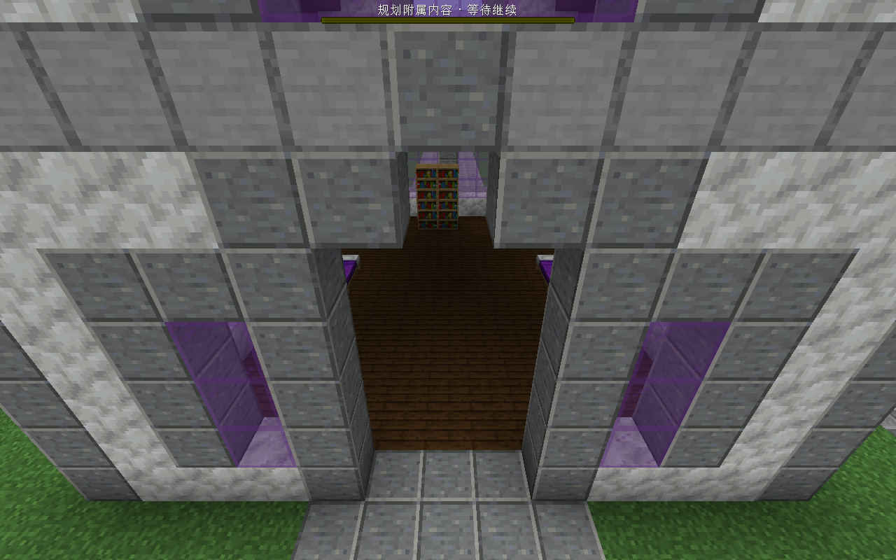
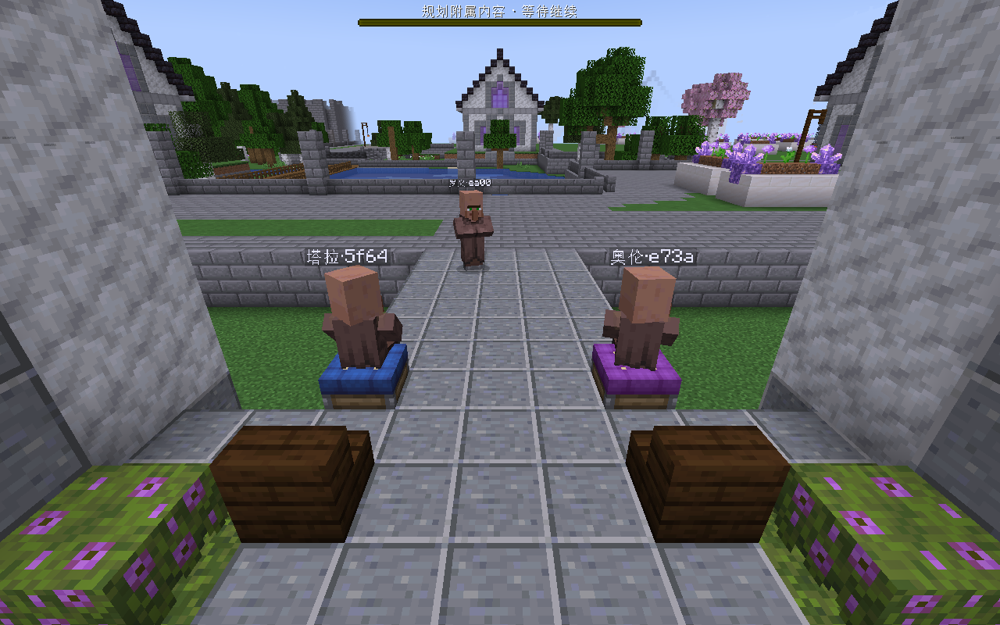
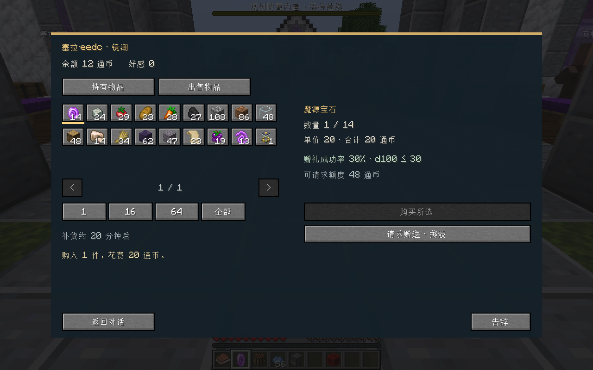

# 0.3 收尾验收 · 2026-10-16

本轮修复与自动、实机验收已通过，供用户确认“城里有人”里程碑。主模组仍为0.2.0，Realmfolk仍为0.4.0；二者独立计版本。

## 结果

| 范围 | 实际结果 |
| --- | --- |
| 全量测试 | 主工程1373项：1358通过、15跳过、0失败/错误；冒险13、核心MCP3、Realmfolk122通过；完整构建与分包检查通过。 |
| 跳过原因 | 14项既有可选本地样本/环境开关，1项本机无符号链接权限；2项Windows运行时测试在本机通过，其他系统显式跳过。 |
| 游戏引擎回归 | 4项Forge GameTest全部通过：绕开杜鹃、普通花草可走、新床发现保留作者活动点、床面附近向下寻找真实出生地。 |
| 素材回归 | Python12项通过；35模板正式导出，仅MG26/27/32的NBT哈希改变，5种小建筑补入口/设施元数据。 |
| 正式生成 | 新学院副本经D4→D7落地51栋，847/847 owner完整，无失败或缺失；12栋住宅共82张可用床。 |
| 居民配置 | 正式快速配置生成32常住居民、3访客；32张独立床位，32/32真实睡眠。住房入住目标69，但受岗位和配额限制尚缺37，预览如实报告。 |
| 宿主接续 | 正式FLASH任务的quick_plan→preview→publish，hostDecisionCommitted=true、taskFinished=true；未重复造人，宿主转入T4。 |
| 生活 | 旧学院副本连续跟随同一研究员从楼上经入口走到约300格外实验楼，再回到原床；两区巡看15个居民/访客均已避雨，雨停恢复。 |
| 家具与商店 | 后加4个Create座椅自动发现、真实乘坐；出售16小麦得32通币，购1魔源宝石花20，余额12、库存15→14、背包+1。 |
| 重载 | 35个UUID、姓名、职业、床位、工位与住址保持，宿主正式发布再次核对一致。 |

新导出小宿舍已可通行，实际床位进入正式人口配置：



真实Create座椅上的坐姿：



真实界面完成的商品交易：



## 本机试玩

从实现仓根目录运行（无需测试接口）：

```powershell
.\addons\realmfolk\scripts\launch-playtest.ps1 `
  -GameDirectory E:\Mod_Dev\StructureBinder\run\campus_d7_playtest `
  -World Realmfolk_Campus03_Updated `
  -PlanningSourceDirectory E:\Mod_Dev\StructureBinder\run\realmfolk_03_wrapup\studio_wrapup_20261016
```

这是本机准备好的存档与素材快照，不包含在Git中。已恢复白天、自然昼夜与天气并保存退出；原始campus_java_acceptance_20261010存档和旧冻结素材未改写。独立旧学院往返测试保存在Realmfolk_Campus03_Wrapup。已测JAR位于主仓build/libs和addons/.realmfolk-build/libs。

## 范围

本轮覆盖当前学院素材和安装的Ars Nouveau、Create、Farmer’s Delight整合环境；Create座椅使用固定marker_seat适配，样例见[设施规则](../examples/create_facility_rules.json)。不表示所有Mod家具都支持，不执行第三方机器内部生产。

旧冻结城市不会因升级自动替换NBT或补铺道路。居民远处未模拟时仍采用原有日程补齐；连续步行结果来自玩家跟随保持模拟，避雨结果来自分区巡看，均不代表全城永久加载。下一阶段领地T4、11城市节奏、正式委托和城际网络仍按路线图排期。

上一轮功能覆盖见[居民生活试玩](居民生活试玩.md)。本轮调用、各轮复现与哈希摘要保存在开发归档；原始大体积日志/调用记录留本机，精简验证汇总随PR提交。
