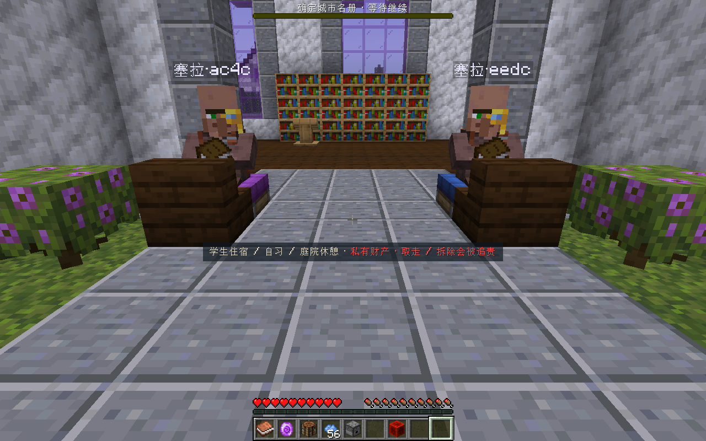
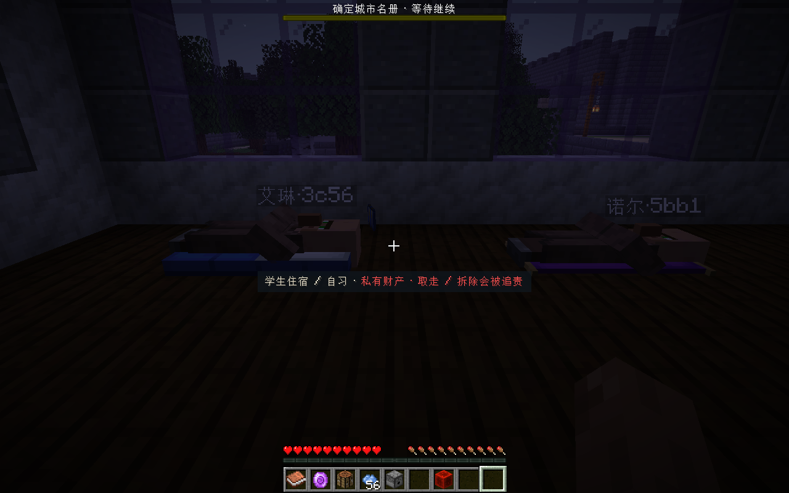

# 可配置生活行为 · 首版

本版提供内置动作、作者配置组合、开发者注册动作三个入口。普通居民继续使用原有身份、住房与日程；行为在居民抵达已确认的设施后执行。配置不会创建不存在的家具或凭空增加岗位。

客户端与服务端需使用这版Realmfolk JAR；网络协议升为3，以避免旧客户端无法识别新增的睡眠朝向数据。单人试玩包已配好。Mod里程碑版本号本轮不变。

## 作者配置

把[示例目录](../examples/living-behaviors)中的两个JSON文件放入游戏目录的`config/realmfolk/`。已有配置时合并对应对象/数组，保留其他规则。`behaviors.json`定义命名行为，`facility_rules.json`把真实方块映射到行为。示例包含Create座椅上的“面向→持书→坐下”，以及Comforts睡袋和吊床的居民睡眠。

示例引用的可选Mod由`requiresMod`控制；没有安装时跳过该设施规则。默认的原版床、工位和原有`marker_seat`配置仍可使用。配置在服务器启动时加载，管理员可用`/realmfolk behaviors reload`重载：先验证完整新配置，成功后停止旧动作并轮转重扫设施；验证失败则保留旧配置及正在进行的动作。

### 行为定义

```json
{
  "schema": 1,
  "behaviors": {
    "academy:read_seated": {
      "kinds": ["seat"],
      "steps": [
        {"action": "realmfolk:face"},
        {"action": "realmfolk:hold_item", "parameters": {"item": "minecraft:book"}},
        {"action": "realmfolk:sit"}
      ]
    }
  }
}
```

`kinds`限定可使用的设施类别。每个行为包含1～16个顺序步骤，目录最多256个行为；自定义名称必须带命名空间，不覆盖内置定义。未知动作、未知参数和无效数值会拒绝加载。

步骤返回完成后进入下一步，已施加的效果仍保留；例如“持书”完成后，书会一直留在手里供后续坐下使用。整段行为结束、被交谈/战斗/同行打断、设施失效或配置成功重载时，按逆序清理全部已启动步骤，释放占用并恢复临时装备。最后一步可以持续运行；所有步骤完成时保持结果，直到作息安排改变。

| 内置动作 | 参数与作用 |
| --- | --- |
| `realmfolk:face` | 无参数；按设施朝向转身。 |
| `realmfolk:hold_item` | `item`：已注册物品ID；临时显示手持物，停止后恢复原装备。不会发给玩家或增加商店库存。 |
| `realmfolk:wait` | `ticks`：1～24000，默认20；等待指定游戏tick。居民作息目前按20tick执行，精度受该周期限制。 |
| `realmfolk:sit` | 可选`height`（0～2），否则使用设施高度；建立居民座位，持续到被打断。 |
| `realmfolk:sleep_bed` | 无参数；使用完整原版兼容床及其占用状态。 |
| `realmfolk:sleep_surface` | 可选`height`（0～2）和`occupiedProperty`（目标方块的布尔占用属性）；在配置设施上进入真正睡眠姿态，记录睡眠锚点。 |
| `realmfolk:work` | `swingInterval`：20～1200，默认60；看向工位并按间隔挥动手臂。 |

睡眠表面适配执行居民的睡眠、位置与占用，不调用第三方Mod为玩家提供的跳过昼夜或重生点逻辑。需要这些专用功能时，开发者可注册对应动作。暂时持物与睡眠会在重载后重新核对，已有居民身份和设施认领保持。

### 设施规则

规则匹配真实方块ID或`#方块标签`，可用`state`筛选方块状态。`kind`支持`bed/seat/work/meeting`，`behavior`引用已加载且允许该类别的行为；`use`保留原有building/resident/guest/care/public/staff用途。`height`是设施表面相对方块底部高度。配置`id`应稳定，供报告和重载定位。

多格家具用`requires`核对其他部分；每项包含`offset`、可选`blocks`或`sameBlock`以及`state`。没有blocks时sameBlock默认true。状态值`$facing`等`$属性名`引用锚点的同名状态值，其他字符串按字面匹配。

偏移基于设施朝向：以朝北时的坐标为基准，x向东、z向南，再随朝向旋转；未提供朝向的方块默认朝北，规则可用`facing`显式指定。`slots`省略时是一个default名额；多人长椅可配置1～8个独立slot，每项有稳定`id`、可选`approach`（整数站位偏移）及`offset`（实际使用点的小数偏移）。每个slot分别占用，不共享一个坐标。第一条匹配同类同slot的规则生效。

睡袋示例只匹配head，要求同方块、同朝向的foot，防止两部分被算成两张床。缺少任一必需部分时不可用于新增人口。真正作为住宅还是客床、病床，仍由作者用途和批准建筑功能共同决定。

设施规则与行为目录可以单独修改。重扫会更新行为适配，保留同一物理slot的ID及作者房间/用途；删除slot会重新核对认领，不删除人物。大量已加载建筑按预算轮转，重载后不保证所有建筑立刻刷新。

## Studio导出

`build_studio_test_bundle.py --living-rules <facility_rules.json>`使用同一套设施匹配。离线提取时在规则文件补目标整合包的`tags`成员快照；导出生活清单携带行为引用、slot、使用偏移和必需部分。运行时按真实方块和已加载行为再次验证；清单中写有行为名称不等于目标游戏已安装该行为。

## 开发者扩展

公共入口位于`com.rinsing.realmfolk.api.life`：监听Forge总线上的`RegisterLivingActionsEvent`，以命名空间ID注册`LivingAction`。事件在启动和显式重载时发送，每轮重新注册；不要保留事件对象。重复ID拒绝，内置动作也使用同一接口。

实现`validate(parameters)`检查配置，`create(context, parameters)`创建每次执行的独立对象。create应只分配状态；在Execution.tick中执行动作并返回RUNNING/COMPLETE/FAILED，在stop中释放该动作创建的资源。所有调用发生在服务器线程。完整上下文提供居民、已占用设施、真实世界、朝向、锚点与使用位置；其他Mod自行决定其专用API调用。

框架保证已创建的Execution会在停止时逆序清理，包括已完成步骤和异常失败；单个清理异常不会阻止其他步骤释放。动作失败不会被替换成另一个动作，生活报告中的livingBehavior提供行为、设施、步骤和错误信息。开发扩展仍须自行保证其第三方资源在stop中释放。

真实Forge GameTest已使用单独命名空间注册探针动作，通过作者配置与持书、坐下组合，并验证停止时探针状态、装备和座位全部恢复。实际客户端结果见下方试玩记录。


## 首版试玩结果 · 2026-10-16

独立副本Realmfolk_Behavior_Config保留原学院35个身份（32常住、3访客），只在测试包加入Comforts 6.4.0，并使用上面的作者配置。原Realmfolk_Campus03_Updated及其游戏目录不变。

- 4个Create座位执行“面向→持书→坐下”；正式交谈使居民起身、释放占用，实际HandItems由book恢复为空。
- 两处住宅床改为Comforts睡袋/吊床，居民真正进入睡眠，使用原bedSite；房间main及用途保留。改动来自管理员正常方块操作，没有直接写NPC姿态或社会存档。
- 交谈打断睡眠，方块occupied恢复false；结束对话后继续使用原睡袋。拆掉睡袋一部分后醒来并报告缺床，补齐后周期扫描重新认领同一床位并恢复睡眠。
- 重载及拆补后35个UUID、姓名、职业、床位、工位、房产归属不变。使用站位会按新家具物理形状重新核对。
- 实体支点高度按配置保持；停止时恢复原重力状态，跨维度恢复不会操作另一维度同坐标的家具。





自动验证：Realmfolk130项单元测试、10项真实Forge GameTest通过；Studio67项Python测试通过，导出包4项聚焦测试通过。主工程全量检查、构建与分包校验通过（1373项、0失败、15项既有样本/权限跳过，部分未改变任务复用Gradle有效结果）。

已知边界：这套适配负责居民生活动作，不执行Comforts的玩家跳时/重生点功能；其他特殊Mod交互由扩展动作实现。群体日历与任意复杂生产流程不在本次首版中。另在既有学院发现小宿舍地基外的持续回家通路问题，已登记待定位；本轮家具动作通过不代表全城持续步行全部通过。

从主仓启动已准备好的本机副本：

```powershell
./addons/realmfolk/scripts/launch-playtest.ps1 `
  -GameDirectory E:/Mod_Dev/StructureBinder/run/realmfolk_behavior_playtest `
  -World Realmfolk_Behavior_Config `
  -PlanningSourceDirectory E:/Mod_Dev/StructureBinder/run/realmfolk_03_wrapup/studio_wrapup_20261016 `
  -PlaytestPort 5121 -DesignerPort 5122 -GeomantiaPort 5111
```

存档已恢复自然昼夜和天气，玩家在主宿舍公共区域。睡袋/吊床位于另一栋住宅内，床头分别为(-2726,65,5223)与(-2726,65,5227)。需要定向观察时，测试存档管理员可用`/time set 12000`看晚间活动，`/time set 13000`看睡眠；保持在附近让居民继续模拟。此存档、第三方Mod和原始日志留本机，不随Git分发。


[开发与分轮验收记录](../../../dev_docs/systems/realmfolk/archive/cd104106_v0.2.0_可配置生活行为与扩展接口/任务记录.md) · [验证统计与最终JAR哈希](../../../dev_docs/systems/realmfolk/archive/cd104106_v0.2.0_可配置生活行为与扩展接口/verification.json)。
