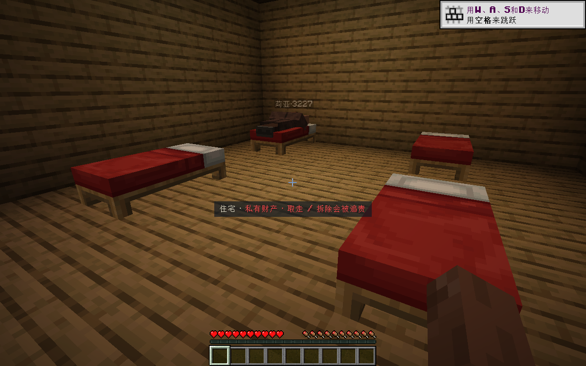
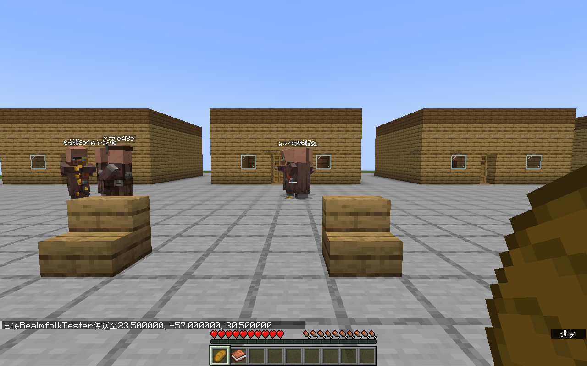
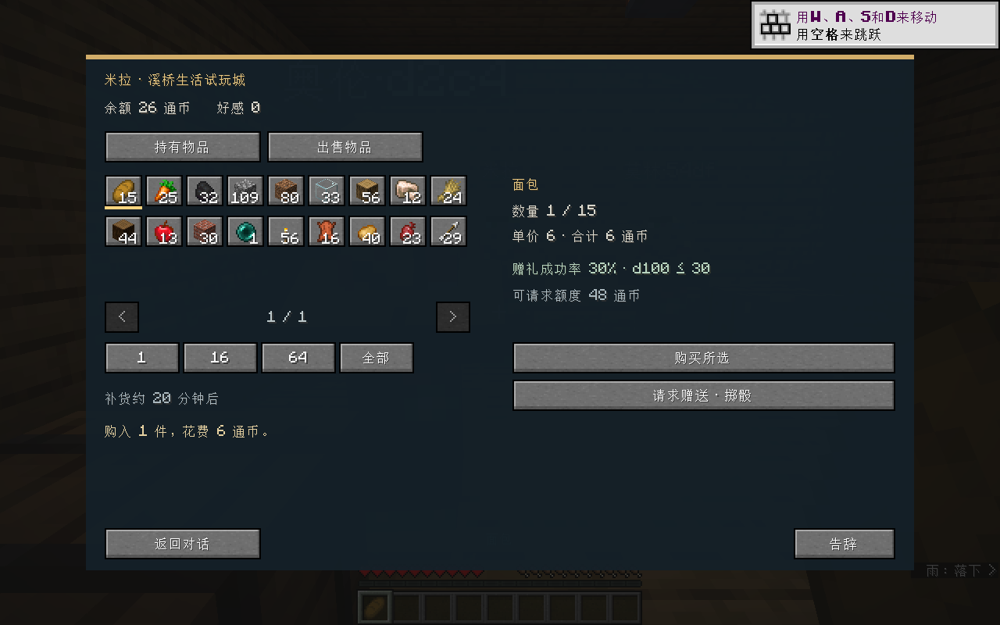
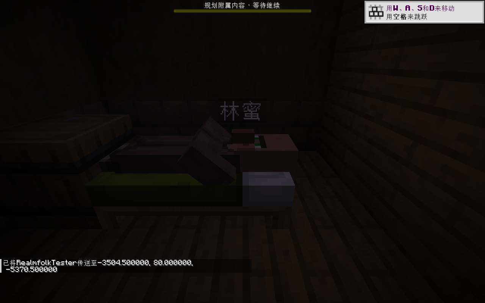

# 0.3 城里有人：开发版试玩

2026-10-15，真实 Minecraft 1.20.1 / Forge 47.4.23 / Java 17 客户端。附属版本仍为 Realmfolk 0.4.0；主模组 0.3 里程碑尚未宣告达成。

## 本机入口

从主仓运行：

```powershell
.\addons\realmfolk\scripts\launch-playtest.ps1 -GameDirectory E:\Mod_Dev\StructureBinder\run\realmfolk_03_playtest -World Realmfolk_Living03 -Designer
```

生活场景为独立超平坦存档 `Realmfolk_Living03`，最终保存时为午间，已恢复自然昼夜流逝。13 位常住居民、2 位访客；保留拆床后的同屋换床结果。测试产生的赔偿已通过正常商店交易及守卫对话付清。

自然城市副本为 `Realmfolk_Natural03_FullPack`，保留原整合包商品池与 Ars Nouveau、Create、Farmer's Delight 等依赖。原 `flash_npc_acceptance_20260927` 世界未修改。请勿把这些本机专用存档名当成仓库自带素材。

## 实际验证

| 场景 | 实际结果 |
| --- | --- |
| 物理设施 | 独立功能场景自动识别 16 张完整床、12 工位、8 座位；正式快速配置经 review、preview、publish 生成 13 常住居民，另有 2 访客。 |
| 一天生活 | 工作到岗、午间聚集、真实进食、3 处坐姿；夜间 13/13 常住居民实际躺床。 |
| 下雨 | 15/15 居民与访客进入室内；雨停恢复作息。 |
| 商店与治安 | 卖 16 小麦得 32 通币、买 1 面包花 6；普通拆床触发财产损坏与守卫查问，随后售出 4 小麦、缴清 32 赔偿，余额 2。 |
| 设施损坏 | 拆掉莉亚原床后，原 UUID、关系与人口保持，认领同屋空床并实际睡入。 |
| 堵门与恢复 | 四张床仍存在时保留认领，报告通路受阻；移除障碍后四人回到各自原床睡觉。 |
| 保存与重载 | 15 个角色身份、全部床位认领、交易余额保持，无重复人口。 |
| 旧自然城市 | 兼容加载既有居民与设施；雨天不再因缺省岗位字段崩溃。发现旧建筑三格高平台缺进屋通道，报告不可达；仅在副本补连续台阶后，林穗自行进屋睡觉。离开区域后返回，林蜜也按远处作息同步到床，身份保持。 |









## 实现与证据边界

设施来自导出 NBT、整合包标签/规则和运行时真实方块核对。导出提取通过 6 项测试，Studio 导出 12 项、素材包回归 6 项；Java 118 项测试全部通过，主模组及附属 JAR 构建成功。

游戏证据为 8 轮共 167 次逐条保存的请求/返回。功能场景由管理员命令搭建，人口由正式设计 MCP 发布；昼夜、雨天用命令加速，挖掘、对话、买卖和赔偿均走实际游戏操作。测试没有直接改写社会存档。

仍需单独处理或继续验收：旧自然城市的全量门前通路与床位素材、全城连续往返、新导出设施清单随自然生成落地的整链、各整合包家具适配。座位当前支持明确配置的 `marker_seat`，没有声称已接入所有 Mod 的原生座椅交互。正式委托和完整世界设定按后续里程碑推进。

旧人口超出现存床位时保留人物并报告缺床；不会补造床、抹掉关系或把临时站位当住房。自然副本中补台阶是受控测试条件，不能算成原城市所有入口已自动修复。当前版本交付为可试玩开发版，里程碑完成与升版本仍待用户确认。

[开发归档与原始证据位置](../../../dev_docs/systems/realmfolk/archive/4a55a38e_v0.2.0_居民生活与城市快速配置/任务记录.md)。

后续以用户已确认 D4 的新学院存档验证导出设施与实际落地，见[镜潮学院 D7 与居民实测](镜潮学院D7与居民实测.md)。
