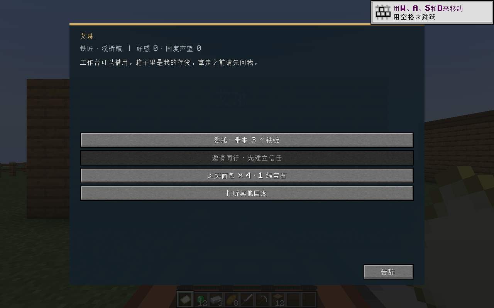
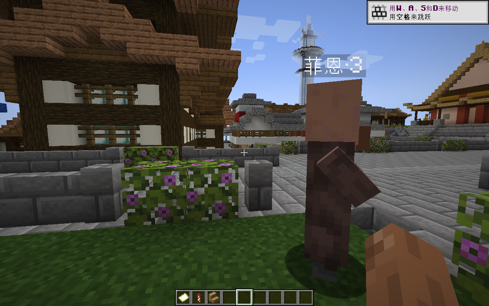
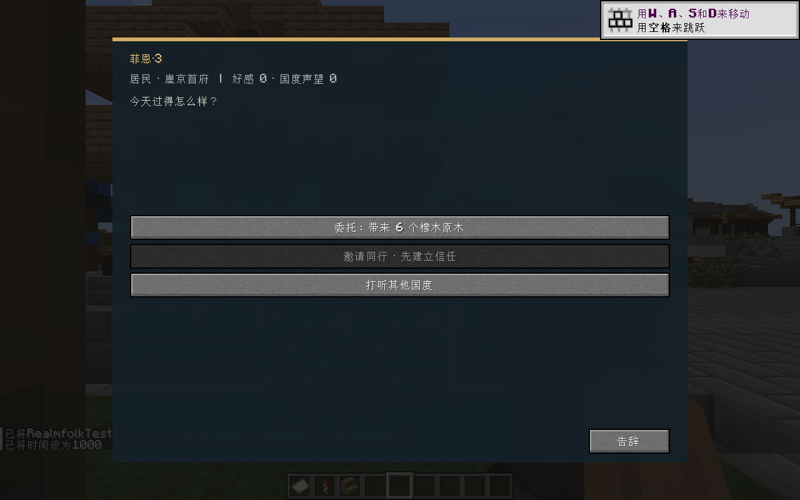
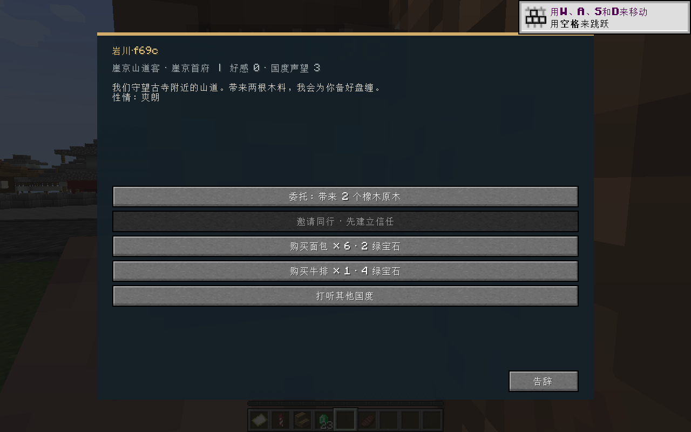
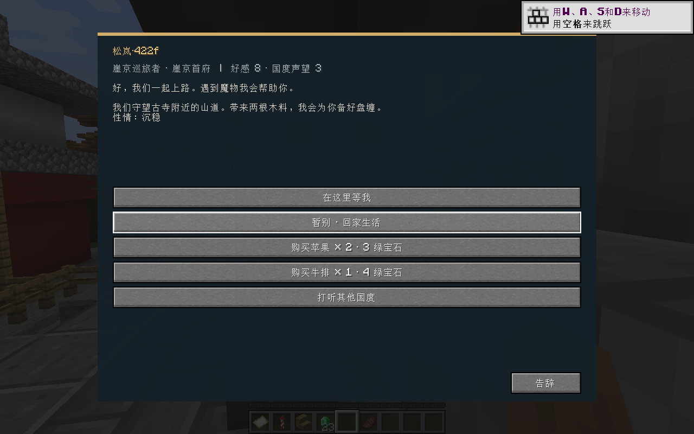
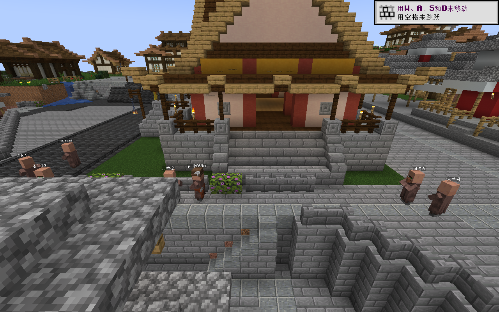
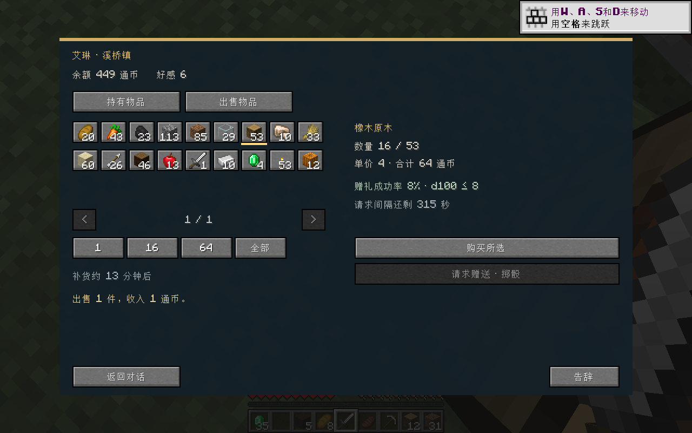
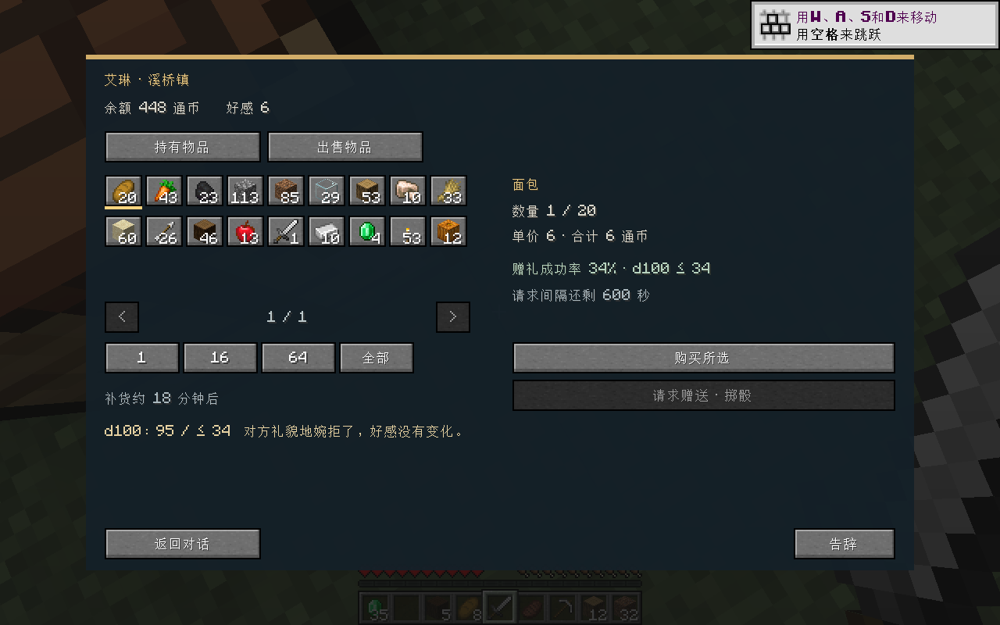

# 试玩版本验证

2026-09-22，Java 17，Minecraft 1.20.1 / Forge 47.4.23。主模组和附属模组都使用实际打包 JAR，非开发环境替身；源码按 Forge 47.4.0 编译。

| 检查 | 结果 |
| --- | --- |
| 主模组打包、附属模组构建 | 通过 |
| 规则单元测试 | 12 项通过 |
| 对话、接取/交付物资、个人与国度关系 | 实际消耗和奖励验证通过 |
| 同伴跟随、等待、再同行 | 通过 |
| 同伴击败讨伐敌人、领取奖励 | 原版战斗日志确认伙伴击杀，实际发放替代奖励；观察阶段对玩家施加抗性，未验证数值平衡 |
| 仅查看箱子 | 无处罚 |
| 目击取物、对话归还、直接放回 | 两种归还均结清纠纷 |
| 挖掘其他居民墙块 | 方块实际消失，产生赔偿，未取消破坏 |
| 轻微报案 / 暴力袭击 | 分别触发警卫查问 / 实际伤害与死亡；缴款结清 |
| 房屋购买、产权保存 | 通过 |
| 传闻位置、实际步行护送、奖励 | 通过 |
| 保存重进 | 居民不重复、关系/产权/委托保留 |
| Geomantia 真实旧城市接入 | 崖京首府住宅接入，6→10 名附近居民；交谈正确显示国度；重载保留 10 名 |
| 同住居民重叠修复 | 同一姓名与身份保持，实际移动到不同站立点 |
| 干净入门存档 | Realmfolk_Start 已保存，9 居民、初始物资与满生命、未领取委托 |

未覆盖的部分：多人联机实测、奖励直接授房分支、各种模组容器、间接破坏归责、完整远途地形与跨海寻路。不应把这些记录解释为完整 RPG 世界或长期平衡已经验收。

测试期间的管理员传送仅用于布置观察位置；背包操作、挖掘、对话、攻击及同伴战斗均通过实际客户端/游戏行为。全部原始调用留在本地 `playtest-evidence/calls.jsonl`，测试目录保存完整运行日志和截图。

## v0.2.0 能力组合与城市设计验证（2026-09-22）

36 项自动测试通过；成品 JAR 内容与真实 Forge 客户端中验证的 JAR 一致。新增覆盖严格配置校验、文化/模板继承、住房和共享岗位容量、确定性生成人物、关键人物名额、发布冲突/重试、关系保护、法律参数及大于 64 KiB 的压缩 NBT 往返。

真实客户端使用独立崖京存档副本，通过正式 MCP 接口提交规则；10 位原有居民保留，生成 4 位新职业人物，其中 1 位关键人物，3 位普通人物由程序抽取。住房位于住宅，工作地点是已批准的宗教建筑。新人物只由一次城市方案发布生成，没有逐人创建调用。

- stdio 初始化与工具发现成功，8 个工具可用；无效能力被拒绝。
- 预览生成 4 人，发布生成 4 人；重复发布返回同一回执。
- 游戏对话实际显示崖京巡旅者、个性标签、2 原木委托和自定义商品。松岚的生命 41.462889、攻击 7.415238、速度 0.288945 均在配置范围内。
- 支付 4 绿宝石获得 1 牛排；交付 2 原木获得 7 绿宝石、8 好感、3 国度声望；背包从 20 → 16 → 23 绿宝石，招募成功。
- 在预览后接取委托，旧发布凭证正确失效。重新预览后保护关键人物和已有委托人物，刷新其余 12 人；岩川变为“崖京山道客”，商品改为 6 面包 / 2 绿宝石，松岚保留原职业与任务内容。
- 正常保存并重新入场：14 人、设计版本 3、已完成委托、同行关系、未发布草案及其完整预览指纹、旧发布回执全部保留，没有重复生成。再次退出日志确认各维度保存完成。
- 对话走远问题和大数据存档问题分别登记 RF-005、RF-006，并在修复后重新验收。

第 2 轮首次预览处于建筑登记尚未完成的启动阶段，按正式 import 命令补齐后继续；这属于工具调用时机修正。运行记录在 `playtest-evidence/mcp-v020.jsonl` 和 `calls.jsonl`，开发归档包含 MCP 请求/返回副本。

成品位于 `releases/0.2.0`。`试玩城市能力.bat` 使用 `.realmfolk-playtest/saves/Realmfolk_Abilities`；它是已验证城市的独立副本，保留配置效果与一次已完成委托及同行关系，不覆盖原有存档。旧版测试 JAR 在该运行目录 `mod-backups` 中备份。城市远途寻路、完整生产经济和剧情仍属于现有原型边界，未声称此次完成。

## v0.3.0 住宅人口与公共生活验证（2026-09-22）

55 项自动测试通过，其中新增 19 项覆盖住房公式、发现新住宅的增量补员、出售/玩家住宅排除、降低密度保留人物、旧版固定人数兼容、其他生物独立计数、职业缺口、活动参与上限/独立站位、跨零点、角色优先级及寻路进展兜底。卡住后的 20 秒退出和 90 秒行程上限由规则测试验证，未在真实城市人工造障碍复现。

实际 Forge 客户端使用已有 `Realmfolk_Abilities` 的独立副本。正式 MCP 一次发布住房方案和职业能力：

| 项目 | 实际结果 |
| --- | --- |
| 住宅和目标 | 初始摘要 9 处 / 36 名额；继续发现后预览为 10 处 / 40 名额，85% 入住率得到目标 34 |
| 批量人口 | 原有 14 人保留，一次新增 20 人；最终居民 30、山道客系列 4，共 34 名 NPC |
| 发布保护 | 12 人可刷新，关键人物与同行伙伴共 2 人受保护；重复发布返回同一回执 |
| 降低密度预览 | 入住率 30% 得到目标 12，现有 34、新增 0，明确提示保留超出目标的 22 人；预览后丢弃，最终保持 85% |
| 午间活动 | 6500 时刻，32 名有资格角色中选择 12 人；12 人实际走到古寺周边活动点，未传送 NPC |
| 时段切换 | 9500 时刻恢复 30 人工作、3 人巡逻、1 人同行；11000 时刻选择 8 人傍晚活动；14000 时刻 33 人回家休息、1 人继续同行 |
| 交谈优先 | 最终版本在午间与阿德交谈，等待 5 秒仍原地“交谈”；关闭后恢复“午间闲逛” |
| 保存重进 | 人数 34、设计版本 4、住房规则与同行关系保留；正式 data 命令读取的 34 个 UUID 集合前后一致 |
| 最终产物复测 | 添加寻路兜底后重新打包、重新启动；人数仍 34，12 人到场，交谈优先有效，正常退出保存完成 |

运行时使用时间命令切换时段、管理员传送移动观察者；居民前往公共场所的移动未通过命令替代。首轮观察者传送误入墙体而死亡，重生后实际拾回原有全部物品；之后改在已观察到的站立点交互。首次交互因距离过远被拒，移动后重试。一次观察者落到低层导致视线失效，最终在同层无遮挡位置重新验证交谈；这些是观察位置/调用修正，不作为模组故障。

最终存档为生存模式、20 生命、正常昼夜流转，背包保留 23 绿宝石及原有地图、鞘翅等物品，原有完成委托和同行伙伴保留。`试玩住宅人口.bat` 使用 `.realmfolk-playtest/saves/Realmfolk_Housing`，不覆盖原有试玩存档。成品在 `releases/0.3.0`，JAR SHA-256 与真实客户端所用产物相同。调用、上下文、预览和日志副本见本次开发归档；原始客户端调用继续保存在本地 `playtest-evidence/calls.jsonl`。

当前公共活动是步行与短暂停留，未实现购物消费、生产经济、睡眠动画或完整社交剧情。256 人是实现保护上限，未进行满负载或多人压测。

## 0.4.0 城市经济与主流程联调（2026-09-24）

隔离实例 `.realmfolk-economy-playtest`，存档 `Realmfolk_Economy`。从当日住房存档复制时实际已有 51 名 NPC（15 处住宅、60 个名额），本轮没有覆盖原存档。另以 demo 命令生成 9 人示范区用于稳定交互测试。

- 主包重构后不用安装 Harness 或地图，也能由主 MCP 收到 Realmfolk 城市任务。雪见岭未加载住宅时发布成功，主流程才进入崖京；重进存档不重复雪见岭任务。
- 崖京保留原模板、关键人物岚川和 51 名居民，经济规则发布 created=0、refreshed=0。
- 出售粗铁和小麦换通币，再购买泥土；委托奖励进入同一账户。保存重载后余额、库存数量和好感一致。
- 普通居民和商人都可主动请求赠礼；实际两次掷骰为 43（要求≤30）和 95（要求≤34），均正常婉拒，无好感处罚，冷却重进后保留。成功分支的扣库存与额度由自动化测试覆盖。
- 修复试玩 sell 动作后再验：出售 1 泥土收入 1，余额 448→449，背包 32→31。
- 83 项自动化测试全过；未使用付费模型，未进行真实多客户端压力测试。

