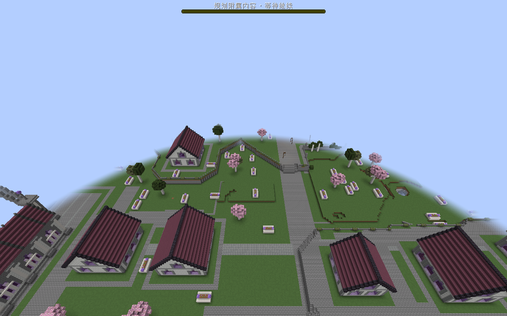
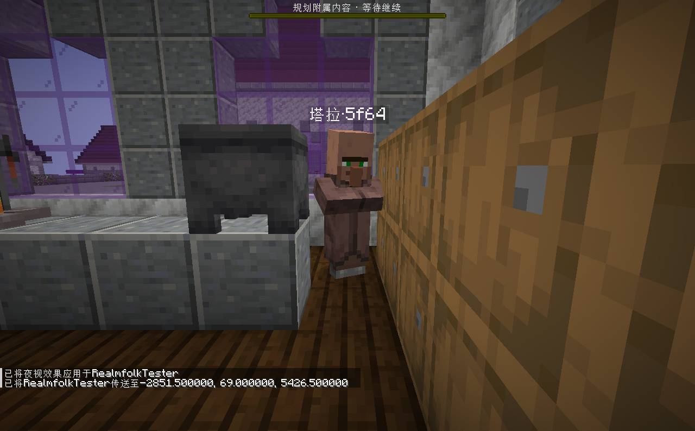
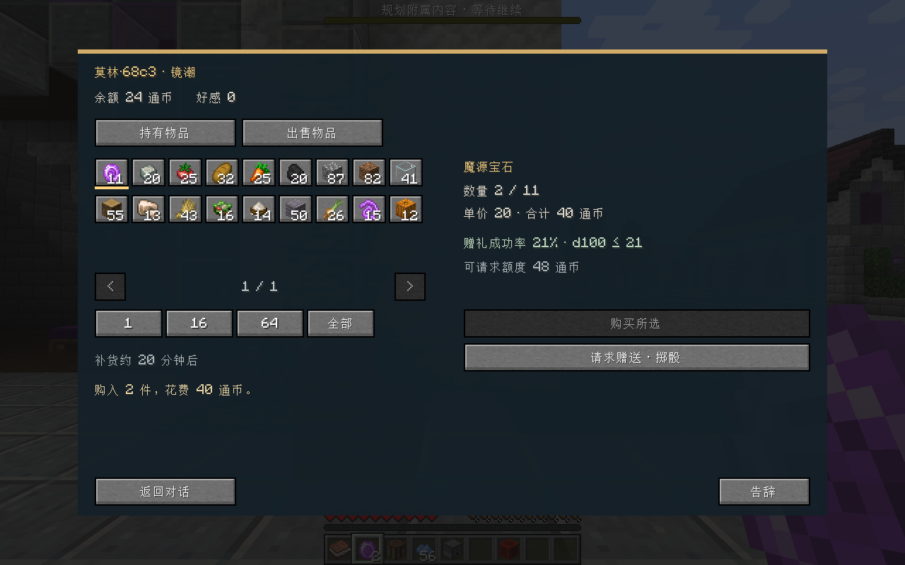

# 镜潮学院 D7 与居民实测

2026-10-15，使用用户魔法学院的已确认 D4 设计，复制存档继续 D7，并测试居民生活与商店。原始 `campus_java_acceptance_20261010` 未修改；模板使用与 D4 hash 一致的 `studio_current_20261007`，51 栋建筑均为当前 `studio:mg-*` 学院素材。

本机可继续游玩的副本：`E:\Mod_Dev\StructureBinder\run\campus_d7_playtest\saves\Realmfolk_Campus03_v2`。启动入口：`run/campus_d7_playtest/开始镜潮学院试玩.bat`。最后保存为白天、晴天、生存模式，玩家位于主宿舍。这些本机存档和素材不是仓库附带资源。

## D7 结果

- 正式队列返回 `CITY_GENERATION_COMPLETED`，51 栋结构通过，844/844 个地表 owner 完成，缺失与失败均为零。
- 600 份补植候选中 503 份准入；72 份因缺承载、25 份因空间占用整份拒绝。按用户确认，不为草木补洞、造台地或自动换位。
- 保存后的 Anvil 核对：503/503 份准入景观的 25,488/25,488 个方块名称一致；待处理补植 owner 为零。此核对不比较连接形状与树叶 distance。
- 指定 chunk 的 worldgen 观测接口返回 `NOT_OBSERVED`，未将其作为成功证据；采用正式 D7 报告与已保存方块核对。

## 居民与商店结果

正式 quick_city → review → preview → publish 发布 13 位居民：4 学生、3 研究员、2 用品商、1 餐食商、1 事务员、2 巡守，另有 2 位访客。真实可用住房来自主宿舍的 16 张床，设施来源为导出模板 hash；没有以虚拟住宅名额代替床。

| 场景 | 实际结果 |
| --- | --- |
| 首次就寝 | 13/13 常住居民实际睡入 13 张不同床。 |
| 重载 | 13 位居民的 UUID 和床位认领完全一致，没有重复人口。 |
| 岗位 | 4 位学生到同楼岗位；按重新接近居民的远处补齐规则，研究员塔拉实际进入实验楼工位并开始工作。后者不是全程步行证据。 |
| 商店 | 出售 32 小麦得到 64 通币，买入 2 个新生魔艺魔源宝石花费 40，余额 24；库存从 13 降至 11，背包实际增加 2 个宝石。 |
| 不可达住房 | 小宿舍床本身存在，但门洞及门外高差不满足通路要求，未纳入新人口容量。 |

## 尚未通过的部分

完整跨区步行和全天巡回仍有缺口。部分居民在上层宿舍或建筑入口停住；一次降雨观察中，14 个已加载实体只有 9 个报告 sheltered，不能宣称全员避雨通过。已加载实体也可能在玩家模拟范围之外，远处日程仅在重新接近时于近距离视野外补齐，不主动加载整城或另造一份人物。

MG27 小宿舍的生成源码已修正“窗框覆盖门洞”，新增室内通路目标和阻断回归；本次没有偷换已冻结 D4 的 NBT/hash。现有副本中的对应旧门洞及门外高差仍需材料重导出和正式入口衔接复验。学院未提供明确可用的座椅点，本轮没有将普通楼梯自动当椅子。

昼夜、天气、玩家位置用命令加速。交易仅通过命令准备了小麦原料，随后使用实际商店按钮；未直接写余额、NPC 位置或社会存档。主模组仍为 0.2.0，0.3 里程碑尚未宣告完整验收。

自动验证补充：本次相关主模组113项、Realmfolk118项和Python2项通过。扩大接口检查仍有6个旧夹具失败（D4必答项与离线D7空serverHolder）；未跳过或删掉这些测试，也未将其计为通过。详见开发归档中的验证说明。
