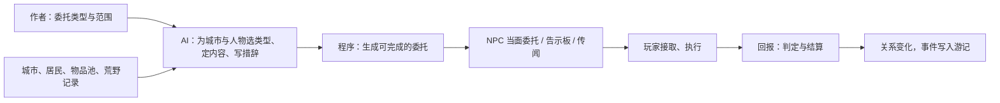

# 委托系统

**案子身份：设计中案 · 2026-10-14。** 本案负责委托的类型、生成、发放、完成判定与结算。居民身份与关系见 [01](01_NPC居民生活与冒险同伴.md)，商品与赠礼见 [05](05_城市物品池与多商品交易.md)，Mod 专属委托与拜师学艺见 [08](08_整合包Mod适配与拜师学艺.md)。跨系统总纲见文档仓 `docs/10_product/异世界冒险体验/README.md`；推荐开发顺序第一步。

## 偶尔有目的，从不强迫

<small>原话：“偶尔能让我有目的知道做什么（因为纯沙盒很多玩家是经常会不知道该做什么的），偶尔又能够不管我想做什么就做什么”</small>

**AI 总结：** 委托是玩家想要方向时随时能找到的目标，全部可选，不接、放弃或失败都不会卡住其他内容。玩家走进任何一座城，都能很快找到可以做的事；不想做时，委托只是城市生活的背景。

## 给类型，AI 选择，程序生成

<small>原话：“而目前我是打算配通用委托类型（如传统RPG、异世界的讨伐xxx、交付xxx道具）和特殊委托类型，也就是由整合包根据mod配置的（比如魔法mod可以累计学习xxx魔法这种），就是尽量给类型，具体的是不是可以LLM选完程序生成”</small>

**AI 总结：** 三方分工：

- **作者**提供委托类型：目标是什么、怎样算完成、内容候选范围、数量范围和奖励档位。
- **AI** 为具体城市与人物挑选合适的类型和具体内容，写出符合当地设定与人物身份的委托措辞。
- **程序**据此生成实际委托，负责完成判定与奖励结算。

委托采用传统 RPG 方式：向 NPC 接取，执行，回去回报。类型分为通用与 Mod 专属两类：

| 通用类型 | 示例 |
| --- | --- |
| 讨伐 | 击败指定的怪物或首领 |
| 清理 | 清除某处营地、巢穴或遗迹里的威胁 |
| 交付 / 寻物 | 带回材料、作物、怪物掉落或特产 |
| 护送 | 陪同商人或居民安全抵达目的地 |
| 探索 | 前往并确认某处地点 |

Mod 专属类型由整合包按已安装的 Mod 配置，例如累计学会若干魔法，见 [08](08_整合包Mod适配与拜师学艺.md)。

## 只发得出能完成的委托

**AI 总结：** 委托的目标必须在这个世界真实存在、可以检查：讨伐与清理的目标取自已记录的荒野怪物与探索结构（冒险内容分布附属模组，见文档仓 `docs/systems/realm_planning/10_product/案子/冒险内容分布附属模组-v0.1/`），交付物取自物品池或当地可获得的资源，Mod 专属目标须对应已安装且可判定的内容。缺少依据时不发出该委托，也不悄悄换成别的类型冒充。

## 谁给委托，在哪里接

**AI 总结：** 委托出自有身份的人：铁匠需要矿石，学者想要遗迹里的书，守卫请人清理附近的魔物营地。每位居民按自己的职业和处境偶尔有事相托；每座城另有告示板汇总公开委托；传闻和路过的商人会带来远方的委托线索。委托数量随城市规模与居民数量变化，并会随时间更新，不出现满城都是任务的情况。

## 回报与关系

**AI 总结：** 完成委托获得统一货币、物品、个人好感与国度声望，与[商品和赠礼](05_城市物品池与多商品交易.md)、[法律与声誉](02_法律声誉与警卫追捕.md)共用同一套关系。连续为同一人或同一城做事，会解锁更深的委托和信任；完成的委托与关系变化写入游记。几步相连的委托组成委托链，拜师学艺是其中一种。

## 多人

**AI 总结：** 每位玩家有自己的委托和进度，与 NPC 的关系分别记录；同一座城的告示板大家共同看到。朋友之间能否一起完成同一个委托，留待多人试玩时确定。
