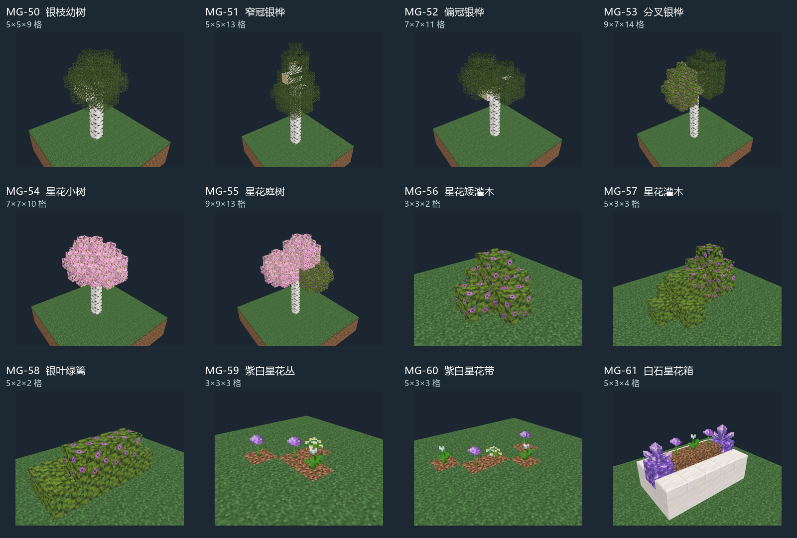

# 学院小型绿化 · 第一批

12 件独立模板，供通用位置规划器选用。白桦枝干、分瓣树冠、粉白花叶、紫白花色及局部白石紫晶形成学院风格。树木没有整块底板，未写入位置保留原地形。



图中每格独立缩放，不能据图片大小比较真实尺寸；草地为预览环境，不在模板内。尺寸按宽×深×高。

| 编号 | 素材 | 尺寸 | 适用位置 |
| --- | --- | --- | --- |
| [MG-50-v01](models/MG-50-v01/previews/front.png) | 银枝幼树 · 小圆冠 | 5×5×9 | 街边、庭院或外围；按树冠净空选型 |
| [MG-51-v01](models/MG-51-v01/previews/front.png) | 窄冠银桦 · 双层尖冠 | 5×5×13 | 街边、庭院或外围；按树冠净空选型 |
| [MG-52-v01](models/MG-52-v01/previews/front.png) | 偏冠银桦 · 伸枝庭树 | 7×7×11 | 街边、庭院或外围；按树冠净空选型 |
| [MG-53-v01](models/MG-53-v01/previews/front.png) | 分叉银桦 · 双瓣树冠 | 9×7×14 | 街边、庭院或外围；按树冠净空选型 |
| [MG-54-v01](models/MG-54-v01/previews/front.png) | 星花小树 · 粉白花冠 | 7×7×10 | 街边、庭院或外围；按树冠净空选型 |
| [MG-55-v01](models/MG-55-v01/previews/front.png) | 星花庭树 · 高低三瓣 | 9×9×13 | 街边、庭院或外围；按树冠净空选型 |
| [MG-56-v01](models/MG-56-v01/previews/front.png) | 星花矮灌木 · 单簇 | 3×3×2 | 墙脚与绿地边缘 |
| [MG-57-v01](models/MG-57-v01/previews/front.png) | 星花灌木 · 高低双簇 | 5×3×3 | 墙脚与绿地边缘 |
| [MG-58-v01](models/MG-58-v01/previews/front.png) | 银叶绿篱 · 短段 | 5×2×2 | 边界短段，可旋转组合 |
| [MG-59-v01](models/MG-59-v01/previews/front.png) | 紫白星花丛 · 散点 | 3×3×3 | 绿地散点；土层嵌入地表 |
| [MG-60-v01](models/MG-60-v01/previews/front.png) | 紫白星花带 · 短段 | 5×3×3 | 绿地散点；土层嵌入地表 |
| [MG-61-v01](models/MG-61-v01/previews/front.png) | 白石星花箱 · 紫晶端饰 | 5×3×4 | 入口与铺装边缘 |

## 模板池与放置

[greenery-pools.json](greenery-pools.json) 提供街边树、庭院树、外围树、矮灌木、绿篱短段、花丛、花箱七个子池；每项含建议权重、尺寸、树冠边界、根点、地面基准、旋转范围和文件哈希。AI 可选子池、调权重或指定单项。2026-10-11 已通过工作台的 `greeneryTemplates` 配置应用第三题学院岛 R30；修改配置后需重新生成。正式 MC 生成尚未接入。

树、灌木、绿篱和花箱按 groundPlaneY=0 贴地。MG-59/60 按 groundPlaneY=1 把局部土层嵌入已有地面；不是抬高一格铺土。对根部及所有写入点检查支撑与净空，不用无空气模板冒充清障。完整包围盒为保守避让范围，不以树干宽度代替树冠尺寸。

所有条目标注 landscape + infrastructure，由程序消费，不作为独立建筑阵列或台地。每种花叶仍是原版叶片，未新增自定义贴图。

## 重建与验收

在 tools/structure_studio 下执行：

```powershell
python -m studio.build MG-50 MG-51 MG-52 MG-53 MG-54 MG-55 MG-56 MG-57 MG-58 MG-59 MG-60 MG-61
python -m studio.academy_greenery
python -m unittest discover -s tests -p test_academy_greenery.py -v
```

12 件通过原版方块状态、NBT 数据及自定义放置约束检查；已实际查看四视角并归档双哈希视觉证据。没有行走点，因此通路报告不用于证明可通行。作者仍为 draft，未进行 Minecraft 实机验收。
