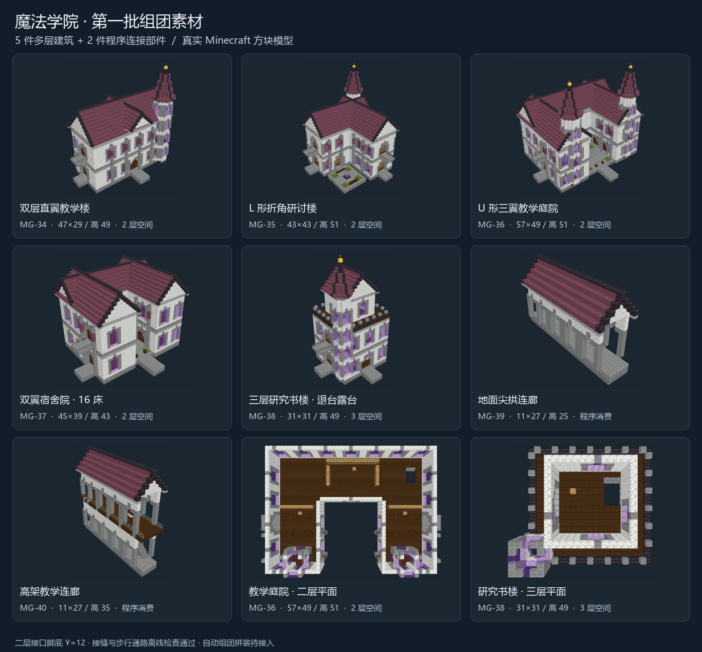

# 魔法学院组团素材 · 第一批

当前缺口是大核心与小屋之间的中型体量，以及能围出院落、连接翼楼的部件。已有礼堂、藏书馆、观星台、炼金所等大建筑仍可继续使用；本批先补多层教学、折角和围院，再补宿舍、研究书楼及两种连接廊。

新增 7 件，编号 MG-34～40，均交付真实原版 1.20.1 NBT、可重建源码、作者标记、结构与通路检查、当前哈希的截图和离线复核记录。作者 lifecycle 继续为 draft，尚未实机验收或获得用户美术认可。



| ID | 素材 | 宽 × 深 / 高 | 可用层与功能 | 消费方 |
| --- | --- | --- | --- | --- |
| MG-34-v01 | [双层教学翼楼](models/MG-34-v01/previews/front.png) | 47 × 29 / 49 | 两层课堂与研读空间，长翼、十字屋脊、端塔 | 建筑阵列 |
| MG-35-v01 | [折角研讨楼](models/MG-35-v01/previews/back.png) | 43 × 43 / 51 | 两层 L 形空间，小组研讨与研究，内凹角花庭 | 建筑阵列 |
| MG-36-v01 | [三翼教学庭院](models/MG-36-v01/previews/front.png) | 57 × 49 / 51 | 两层 U 形教学、研读空间，敞开内庭与双门塔 | 建筑阵列 |
| MG-37-v01 | [双翼宿舍院](models/MG-37-v01/previews/front.png) | 45 × 39 / 43 | 两层 16 床，共享书廊及窄庭 | 建筑阵列 |
| MG-38-v01 | [阶顶研究书楼](models/MG-38-v01/previews/front.png) | 31 × 31 / 49 | 三层研读研究空间，退台露台 | 建筑阵列 |
| MG-39-v01 | [地面尖拱连廊](models/MG-39-v01/previews/front.png) | 11 × 27 / 25 | 开放两端的地面通路及五开间廊顶 | 程序基础设施 |
| MG-40-v01 | [高架教学连廊](models/MG-40-v01/previews/front.png) | 11 × 27 / 35 | 地面及二层通路、实体楼梯、支墩与护栏 | 程序基础设施 |

建筑基础按楼体和通路制作，L/U 形中庭上方没有楼板封盖。当前阵列仍按模板包围盒占位；稀疏基础并不意味着现有算法会自动填入内凹空间。

## 连接约定

本约定仅用于作者 `connections`，不扩充正式运行时模板契约。每项保存 `id`、对应 `point_id`、`kind=academy_gallery`、局部 `pos`、向外 `direction`、`standing_y`、`width=3`、`height=4` 及说明。`pos` 是模板边缘端口中心地板上方的脚底位置；配对时方向相反、脚底同高，两端的边缘方块相邻。旋转须同时旋转坐标、朝向和实际方块状态。

教学组团首层地板方块 Y=1，脚底 Y=2；二层地板方块 Y=11，脚底 Y=12。三层研究书室脚底 Y=22，不作为本批连接廊接口。所有端口中央 3 格宽、4 格高净空，外伸二层阈口两侧有护栏。MG-39 只有地面接口；MG-40 有地面与二层接口，可从自身楼梯登上高层。

已验证两组手工拼接：MG-34 → 顺时针旋转 90° 的 MG-39 / MG-40 → MG-34。实际导出方块的接缝地板连续、头顶净空连续，并以单一左栋入口核验跨栋通路。自动选廊、适配长度、落地支撑及给旧文化核心补接口均尚未实现；基础设施不能作为学院阵列成员。

## 重建与检查

在 `tools/structure_studio` 运行：

```powershell
python -m studio.build MG-34 MG-35 MG-36 MG-37 MG-38 MG-39 MG-40
python scripts/check-academy-wings.py
$env:STUDIO_CHROMIUM='C:/Program Files (x86)/Microsoft/Edge/Application/msedge.exe'
node scripts/capture-academy-wings.mjs MG-34-v01 MG-35-v01 MG-36-v01 MG-37-v01 MG-38-v01 MG-39-v01 MG-40-v01
```

脚本使用正在运行的 8767 工作台中的 `/index.html` 结构库页面。重新截图后需实际查看并填写复核记录，才能通过 `studio.publish` 归档到模型的 `previews/`；不能沿用旧哈希的审查。

本轮 7 项结构、方块状态、楼层通路及 26 个端口检查通过；两组手工连接通路通过，浏览器 70 张截图无脚本异常或纹理缺失。证据位于 `runtime/campus-workbench/academy-wings-check.json` 和每个模型的 `validation.json`、`review.json`、`previews/capture.json`。

现有学院 R7 未换用本批建筑。刷新工作台可在建筑选择器中选取前五项；两件连接廊只能在结构库预览。下一步需要调整核心周围的选材、实际宽深、朝向与连接规划，才能把素材变成参考图中的连续建筑群。
