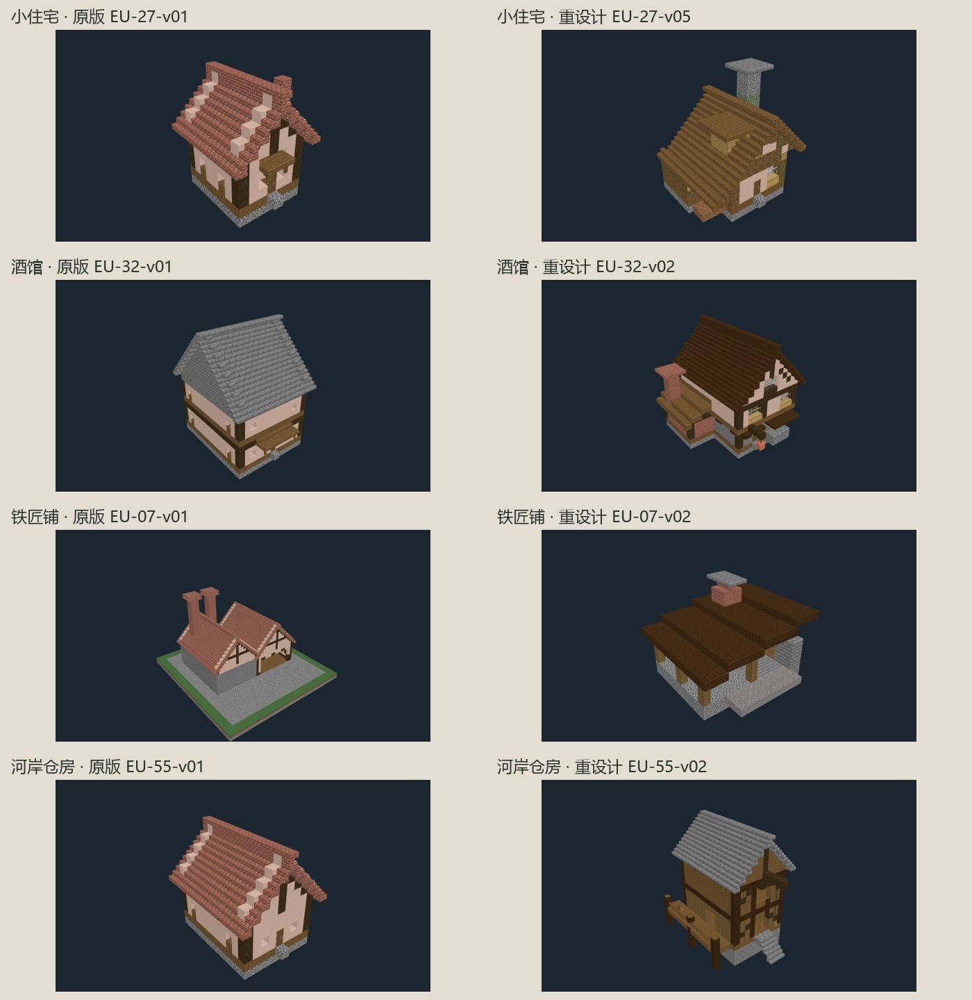
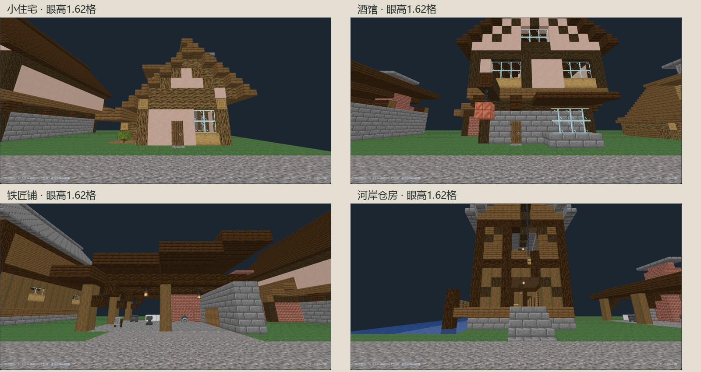
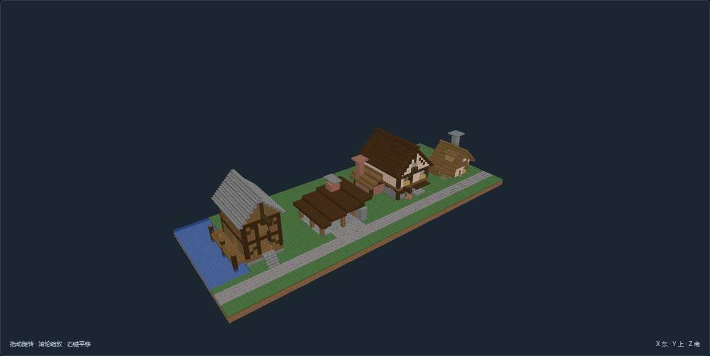

# 欧洲建筑 · 四栋特色重设计

2026-10-21。用户指出上一批缺乏特色，本轮先重做四种不同用途的代表建筑。**当前是四栋设计候选，视觉风格待用户判断；没有宣称整套 68 个版本已完成风格重做。**

上一批 68 个版本保留为功能与尺度原型；其 review.json 当前状态改为 needs_redesign，原始技术报告和几何保留，先前作者评审见提交 20f0263a。四栋新模型使用新版本号，不覆盖旧资产。

## 前后对照

单体图按各自画面适配缩放，用来比较轮廓；不能从图中大小推算实际占地。铁匠铺对照的是早期大型 EU-07-v01，其余三项对照上一批原型。

| 新版本 | 本轮改变 | 总包围盒：宽×深×高 | 住床／客床／员工床 | 工作点 |
| --- | --- | --- | --- | ---: |
| [EU-27-v05](models/EU-27-v05/previews/front.png) | 不对称长短坡屋顶、偏心石烟囱、低檐储物侧屋、屋顶小窗；主屋与侧屋真实连通 | 14×15×15 | 2／0／0 | 0 |
| [EU-32-v02](models/EU-32-v02/previews/front.png) | 挑楼客房与可见托梁、街面凸窗、铜壶招牌、独立低厨房及砖烟囱 | 20×23×20 | 0／4／1 | 2 |
| [EU-07-v02](models/EU-07-v02/previews/front.png) | 石炉背墙、收窄排烟罩、低敞棚、砧台与淬水区；临街面打开，直接展示生产 | 18×17×13 | 0／0／0 | 2 |
| [EU-55-v02](models/EU-55-v02/previews/front.png) | 抬高仓体、上层吊货口、悬臂吊架、侧向装卸廊和落地桩；区别于住宅开窗 | 16×22×21 | 0／0／0 | 2 |

小宅主屋外墙为 8×10 格，另有低侧屋；14×15 包含烟囱、长檐与门前构件。酒馆首层大厅外墙为 11×16，另有厨房和挑楼。本轮总包围盒比前一批部分小型参考值更大，增量来自明确的生活／经营空间及构架，而非空广场底板；没有把它们作为所有民居的统一尺寸。

## 玩家高度与统一尺度

观察点脚底 Y=2、眼高增加 1.62 格，使用 Studio 漫游相机。这是离线预览，不是 Minecraft 截图。

四栋在同一条人工摆放街道上，仓房侧面为水岸示意。该场景只验证相对体量与展示关系，不证明真实地形落地或自动城市生成。

## 检查与边界

- 四栋数据检查、真实床头床尾、入口到全部标记使用点的离线通路检查通过，零警告；4 项针对结构与用途的测试通过。
- 四栋 NBT、作者标记和生活设施文件由源码逐字节重建一致；65 张单体截图与 30 张街景截图无浏览器渲染错误。相机视角与素材哈希保存在 capture.json。
- 新版 review.json 为 pending_user_design_review；当前不把“技术通过”写成“用户认可特色”。
- 本轮没有改城市选材逻辑，没有安装到游戏实例，也没有验收 NPC、夜间光照、流体、排烟或吊货机制。吊架与烟囱是建筑表达。
- 重建：在 tools/structure_studio 中执行 `python -m studio.european_character`；亦支持已有 `python -m studio.build <编号>` 入口。重建后截图哈希变化时应重新查看。
