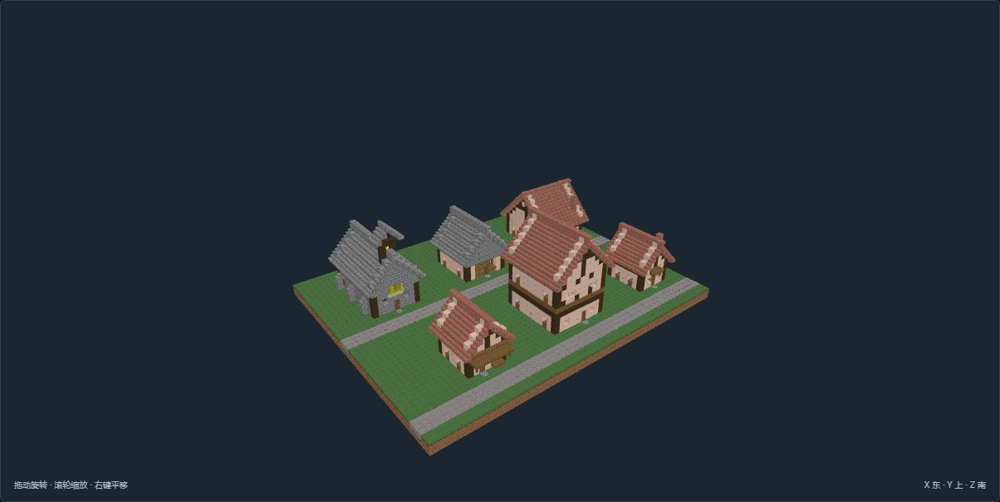

# 欧洲紧凑建筑 · 本轮交付

2026-10-21。本轮 68 个版本：EU-27～45 的 19 个新增类型及变体、EU-46～67 的 22 个地域配套类型，共 61 个新建版本；另有 7 个既有类型的修订版。旧版保留，欧洲目录现共 94 个版本、67 个独立编号。

全部完成最终 NBT 数据、离线通路检查与外观／分层图审，逐项 review.json 绑定当前 NBT 和作者文件双哈希。图审是本轮作者判断，不代表用户已认可审美。

未安装到游戏实例，未验证实际世界生成、NPC 路径、动物通过、流体、机器或夜间照明。坡地小屋目前只声明两格坡差；栈桥声明固定岸高与水位基准，不代表适配所有地形。

[交互图册](紧凑建筑图册.html) · [逐项验收摘要](紧凑建筑验收摘要.json) · [制作清单](补充建模清单.md)

上图是手工摆放的离线尺度对照场景，不是城市生成成果。

| 编号／外观 | 建筑 | 宽×深×高 | 居民床 | 客床 | 员工床 | 病床 | 工位 |
| --- | --- | --- | ---: | ---: | ---: | ---: | ---: |
| [EU-02-v02](models/EU-02-v02/previews/front.png) | 十字钟塔教堂 · 圆券侧廊与后部半圆祭堂 | 65×81×46 | 0 | 0 | 0 | 0 | 2 |
| [EU-03-v02](models/EU-03-v02/previews/front.png) | 市政会馆 · 石券底廊与三山墙挑楼 | 61×57×28 | 0 | 0 | 0 | 0 | 3 |
| [EU-05-v02](models/EU-05-v02/previews/front.png) | 挑楼街屋 · 紧凑三层三户 | 13×17×24 | 9 | 0 | 0 | 0 | 0 |
| [EU-15-v02](models/EU-15-v02/previews/front.png) | 商人行会馆 · 阶梯山墙与双层秤量厅 | 57×61×39 | 0 | 0 | 0 | 0 | 2 |
| [EU-16-v02](models/EU-16-v02/previews/front.png) | 城镇钟楼 · 石基木钟室与四面表盘 | 39×43×54 | 0 | 0 | 0 | 0 | 1 |
| [EU-18-v02](models/EU-18-v02/previews/front.png) | 双窑面包坊 · 前店木屋与后部圆窑 | 49×53×28 | 0 | 0 | 0 | 0 | 2 |
| [EU-21-v02](models/EU-21-v02/previews/front.png) | 守卫营房 · 双层二十四床 | 19×23×22 | 24 | 0 | 0 | 0 | 1 |
| [EU-27-v01](models/EU-27-v01/previews/front.png) | 木架小屋 · 端门双床与灶角 | 9×11×12 | 2 | 0 | 0 | 0 | 0 |
| [EU-27-v02](models/EU-27-v02/previews/front.png) | 木架小屋 · 侧门长屋与储物间 | 9×13×12 | 2 | 0 | 0 | 0 | 0 |
| [EU-27-v03](models/EU-27-v03/previews/front.png) | 木架小屋 · 短翼储物间 | 11×13×12 | 2 | 0 | 0 | 0 | 0 |
| [EU-27-v04](models/EU-27-v04/previews/front.png) | 木架小屋 · 两格坡差与上坡寝室 | 9×14×14 | 2 | 0 | 0 | 0 | 0 |
| [EU-28-v01](models/EU-28-v01/previews/front.png) | 半木架家宅 · 双层山墙四床 | 13×15×19 | 4 | 0 | 0 | 0 | 0 |
| [EU-28-v02](models/EU-28-v02/previews/front.png) | 半木架家宅 · 窄面侧廊六床 | 11×15×18 | 6 | 0 | 0 | 0 | 0 |
| [EU-28-v03](models/EU-28-v03/previews/front.png) | 半木架家宅 · 短L形餐厅翼 | 15×15×12 | 4 | 0 | 0 | 0 | 0 |
| [EU-29-v01](models/EU-29-v01/previews/front.png) | 连排街屋 · 共墙中户 | 7×13×18 | 2 | 0 | 0 | 0 | 0 |
| [EU-29-v02](models/EU-29-v02/previews/front.png) | 连排街屋 · 山墙端户 | 7×13×18 | 2 | 0 | 0 | 0 | 0 |
| [EU-29-v03](models/EU-29-v03/previews/front.png) | 连排街屋 · 转角侧门户 | 7×13×18 | 2 | 0 | 0 | 0 | 0 |
| [EU-30-v01](models/EU-30-v01/previews/front.png) | 下店上宅 · 杂货双层店屋 | 11×13×18 | 2 | 0 | 0 | 0 | 1 |
| [EU-30-v02](models/EU-30-v02/previews/front.png) | 下店上宅 · 布料裁衣店屋 | 11×13×18 | 2 | 0 | 0 | 0 | 1 |
| [EU-31-v01](models/EU-31-v01/previews/front.png) | 富商宅邸 · 石基门厅与三翼小院 | 21×23×12 | 8 | 0 | 0 | 0 | 1 |
| [EU-32-v01](models/EU-32-v01/previews/front.png) | 街角酒馆 · 横脊客房与侧厨房 | 15×19×21 | 0 | 4 | 2 | 0 | 2 |
| [EU-33-v01](models/EU-33-v01/previews/front.png) | 小商铺 · 杂货前店后仓 | 9×11×12 | 0 | 0 | 0 | 0 | 1 |
| [EU-33-v02](models/EU-33-v02/previews/front.png) | 小商铺 · 工具转角售卖 | 11×11×13 | 0 | 0 | 0 | 0 | 1 |
| [EU-33-v03](models/EU-33-v03/previews/front.png) | 小商铺 · 药草采光柜台 | 9×11×12 | 0 | 0 | 0 | 0 | 1 |
| [EU-34-v01](models/EU-34-v01/previews/front.png) | 集市摊棚 · 布料单面棚 | 7×7×7 | 0 | 0 | 0 | 0 | 1 |
| [EU-34-v02](models/EU-34-v02/previews/front.png) | 集市摊棚 · 果蔬双开口 | 7×7×7 | 0 | 0 | 0 | 0 | 1 |
| [EU-34-v03](models/EU-34-v03/previews/front.png) | 集市摊棚 · 陶器贴墙棚 | 7×7×7 | 0 | 0 | 0 | 0 | 1 |
| [EU-35-v01](models/EU-35-v01/previews/front.png) | 草药诊所 · 采光病室与药柜 | 11×15×13 | 0 | 0 | 0 | 2 | 1 |
| [EU-36-v01](models/EU-36-v01/previews/front.png) | 公共洗浴 · 开敞洗衣棚 | 9×11×12 | 0 | 0 | 0 | 0 | 2 |
| [EU-36-v02](models/EU-36-v02/previews/front.png) | 公共洗浴 · 双池浴室与更衣间 | 15×17×15 | 0 | 0 | 0 | 0 | 1 |
| [EU-37-v01](models/EU-37-v01/previews/front.png) | 街口哨亭 · 开敞木亭 | 5×5×9 | 0 | 0 | 0 | 0 | 1 |
| [EU-37-v02](models/EU-37-v02/previews/front.png) | 街口哨亭 · 石墙值守亭 | 5×5×9 | 0 | 0 | 0 | 0 | 1 |
| [EU-38-v01](models/EU-38-v01/previews/front.png) | 街角配套 · 双人长椅 | 7×5×4 | 0 | 0 | 0 | 0 | 0 |
| [EU-38-v02](models/EU-38-v02/previews/front.png) | 街角配套 · 布告栏与停留位 | 7×5×6 | 0 | 0 | 0 | 0 | 0 |
| [EU-39-v01](models/EU-39-v01/previews/front.png) | 教区学堂 · 八席课堂与书柜 | 13×15×14 | 0 | 0 | 0 | 0 | 1 |
| [EU-40-v01](models/EU-40-v01/previews/front.png) | 农舍 · 低矮横厅与四床后室 | 13×15×14 | 4 | 0 | 0 | 0 | 0 |
| [EU-40-v02](models/EU-40-v02/previews/front.png) | 农舍 · 分隔寝室与侧入灶间 | 13×15×14 | 4 | 0 | 0 | 0 | 0 |
| [EU-41-v01](models/EU-41-v01/previews/front.png) | 畜牧配套 · 双栏饲养棚 | 11×15×13 | 0 | 0 | 0 | 0 | 1 |
| [EU-41-v02](models/EU-41-v02/previews/front.png) | 畜牧配套 · 独立双门围栏 | 11×15×3 | 0 | 0 | 0 | 0 | 1 |
| [EU-42-v01](models/EU-42-v01/previews/front.png) | 木匠作坊 · 临街封闭工房 | 11×13×13 | 0 | 0 | 0 | 0 | 2 |
| [EU-42-v02](models/EU-42-v02/previews/front.png) | 木匠作坊 · 林边开敞工棚 | 11×13×13 | 0 | 0 | 0 | 0 | 2 |
| [EU-43-v01](models/EU-43-v01/previews/front.png) | 村庄礼拜堂 · 山墙钟架与单厅 | 11×17×18 | 0 | 0 | 0 | 0 | 1 |
| [EU-43-v02](models/EU-43-v02/previews/front.png) | 村庄礼拜堂 · 侧塔与石砌小堂 | 11×17×18 | 0 | 0 | 0 | 0 | 1 |
| [EU-44-v01](models/EU-44-v01/previews/front.png) | 路边神龛 · 独立木顶石龛 | 5×5×9 | 0 | 0 | 0 | 0 | 0 |
| [EU-44-v02](models/EU-44-v02/previews/front.png) | 路边神龛 · 贴墙小龛 | 5×5×6 | 0 | 0 | 0 | 0 | 0 |
| [EU-45-v01](models/EU-45-v01/previews/front.png) | 渔家小屋 · 侧向网具操作廊 | 11×13×12 | 2 | 0 | 0 | 0 | 1 |
| [EU-46-v01](models/EU-46-v01/previews/front.png) | 独立谷仓 | 11×15×14 | 0 | 0 | 0 | 0 | 1 |
| [EU-47-v01](models/EU-47-v01/previews/front.png) | 村口小粮磨 | 13×15×14 | 0 | 0 | 0 | 0 | 2 |
| [EU-48-v01](models/EU-48-v01/previews/front.png) | 小型烘焙屋 | 11×13×13 | 0 | 0 | 0 | 0 | 2 |
| [EU-49-v01](models/EU-49-v01/previews/front.png) | 独立粮食晒场 | 13×13×3 | 0 | 0 | 0 | 0 | 1 |
| [EU-50-v01](models/EU-50-v01/previews/front.png) | 林务小屋 | 9×13×12 | 2 | 0 | 0 | 0 | 1 |
| [EU-51-v01](models/EU-51-v01/previews/front.png) | 木料堆场 | 13×15×11 | 0 | 0 | 0 | 0 | 1 |
| [EU-52-v01](models/EU-52-v01/previews/front.png) | 炭烧棚 | 13×15×11 | 0 | 0 | 0 | 0 | 1 |
| [EU-53-v01](models/EU-53-v01/previews/front.png) | 小渡口候船棚 | 11×13×10 | 0 | 0 | 0 | 0 | 1 |
| [EU-54-v01](models/EU-54-v01/previews/front.png) | 桥头收费屋 | 9×11×12 | 0 | 0 | 0 | 0 | 1 |
| [EU-55-v01](models/EU-55-v01/previews/front.png) | 岸边仓房 | 11×15×13 | 0 | 0 | 0 | 0 | 1 |
| [EU-56-v01](models/EU-56-v01/previews/front.png) | 分段木栈桥 | 7×13×5 | 0 | 0 | 0 | 0 | 0 |
| [EU-57-v01](models/EU-57-v01/previews/front.png) | 山口旅舍 | 13×17×14 | 0 | 8 | 0 | 0 | 1 |
| [EU-58-v01](models/EU-58-v01/previews/front.png) | 山口小关卡 | 13×15×14 | 0 | 0 | 0 | 0 | 1 |
| [EU-59-v01](models/EU-59-v01/previews/front.png) | 矿口作业棚 | 11×13×10 | 0 | 0 | 0 | 0 | 2 |
| [EU-60-v01](models/EU-60-v01/previews/front.png) | 矿料分拣仓 | 13×15×14 | 0 | 0 | 0 | 0 | 2 |
| [EU-61-v01](models/EU-61-v01/previews/front.png) | 渔网棚 | 9×13×9 | 0 | 0 | 0 | 0 | 1 |
| [EU-62-v01](models/EU-62-v01/previews/front.png) | 腌鱼作坊 | 11×13×13 | 0 | 0 | 0 | 0 | 2 |
| [EU-63-v01](models/EU-63-v01/previews/front.png) | 小船棚 | 13×19×16 | 0 | 0 | 0 | 0 | 1 |
| [EU-64-v01](models/EU-64-v01/previews/front.png) | 庄园管事屋 | 11×13×13 | 2 | 0 | 0 | 0 | 1 |
| [EU-65-v01](models/EU-65-v01/previews/front.png) | 侍从住处 | 13×15×14 | 8 | 0 | 0 | 0 | 1 |
| [EU-66-v01](models/EU-66-v01/previews/front.png) | 朝圣旅舍 | 13×19×14 | 0 | 12 | 0 | 0 | 1 |
| [EU-67-v01](models/EU-67-v01/previews/front.png) | 水磨进出水渠段 | 7×15×3 | 0 | 0 | 0 | 0 | 1 |

## 复核与重建

- Studio 中可逐项查看实际模型、切片、房间与使用点；每个模型保留作者标记、生活设施提取、数据检查、截图和图审记录。
- 在 `tools/structure_studio` 运行 `python -m studio.european_village` 重建本批全部；亦已接入原 `python -m studio.build <ID>` 入口。重建后若哈希变化，旧图审自动失效，须重新截图查看。
- 11 项聚焦测试通过，覆盖本批范围、真实床位与标记、旧版保护、L 形空地、既有楼层通路与分类。
- 小屋现有端门、侧门、短翼及两格坡差版本；家宅有四床、六床与 L 形；街屋有中户、端户、转角；配套包含独立棚、围栏、栈桥与渠道。
- 尺寸超过原建议的条目保留实际尺寸：L 形家宅为 15×15，摊棚含檐口为 7×7；参考范围不是缩通路或截屋檐的理由。
- 默认作者生命周期仍为 draft；离线接受状态由 review.json 表达，不自动晋升为运行时已导入。
