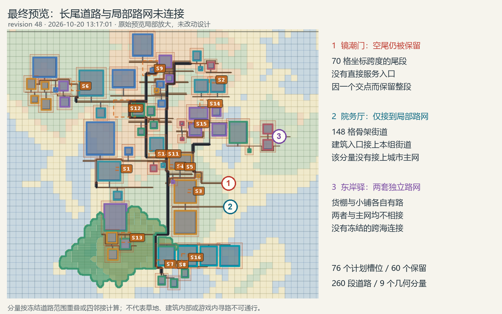

# session-fc974f93 诊断

结论：建筑冲突确实存在，直接导致建筑被跳过和定稿被拒绝；图上的大量道路长尾还叠加了骨架保留策略与局部路网未相接的问题，不能全部解释成道路撞楼后被截断。

## 证据范围与版本

- 会话：session-fc974f93-8fe5-4c92-a798-51e4b30c8139；原文件位于用户指定的 `.dsh/sessions/--C-Users-Rinsing-Documents-deepseek-harness-default-workspace--` 目录。
- 原工作区：`C:\Users\Rinsing\Documents\deepseek-harness\default-workspace`，读取 `mcp/out`、`mcp/d4` 与 `mcp/images`。
- 世界：`Academy_D3_04_20261020`，run `provider_3d25631f_r19200`，city `city_jingchao_capital`。
- 对照当前实现 HEAD `eaf91397`；未核验运行 jar 与该提交逐字一致，因此源码用于解释与产物一致的机制，不声称完成运行时复现。
- 工作区 `preview_city_final.png` 实际是 13:15:35 的 revision 46，81/65；13:17:01 最后成功编译的是 revision 48，76/60。最后没有再次成功定稿。
- 以下统计默认使用 revision 48，草稿 hash `sha256:05e80c99471d13fc54c22ad2123c8e4f1b340f2b97aadd48ba47beb58ff83882`。

## 道路问题

### 1. 预设街道保留整段，空尾没有收短

最终 `streetFirstNetworkTrace`：92 段预留骨架全部保留，`removedUnusedSegmentCount=0`。其中 85 段的 `servedEntranceIds` 为空；这不表示 85 段全无用途，其中一些承担转接，但说明不能把“被保留”当成逐段服务真实入口的证明。

当前 `CityInternalStreetPlanner.finalizeSkeleton`（约第 76–100 行）只有在没有附近入口、没有交点、也不算同组临街面时才删除整段。一段路只要一端碰到别的路就可被保留；没有按最后一个实际入口/交点裁掉剩余尾段的步骤。

具体例子：

- 镜潮门 `g_gate`：`(-2789,5269) → (-2719,5269)`，坐标跨度 70 格；`servedEntranceIds=[]`、`junctionCount=1`、`usageReview=SHARED_TRANSIT_JUNCTION`。图中向右伸入空地的尾巴确实在冻结数据中。
- 院务厅 `g_council`：`(-2864,5330) → (-2716,5330)`，跨度 148 格；骨架复核时没有近邻入口、没有其他骨架/主路交点，因 `SERVES_DISTRICT_FRONTAGE` 保留整段。后续短巷把本组建筑接上这条路，但没有接上城市主网。

这是已确认的实现缺口；建筑被裁掉可能扩大无用途尾段，但不能把每段长尾都归因于一次建筑碰撞。

### 2. 接到本组街道，不等于接到全城路网

最终 30 个建筑组只有 8 条显式 CONNECTION。8 条主路均生成，`skippedConnectionCount=0`、`bridgeConnectionCount=0`。早期评语里的“4 条跨区主路不可达”不是最终版的当前数值。

对冻结 `streetBands[].bounds` 做几何连通检查：矩形重叠或存在四邻接格才连接，260 段道路分成 9 个分量。最大分量 211 段，其他 8 个分别属于：

| 局部道路分量 | 段数 |
| --- | ---: |
| 东岸驿货棚 `g_harbor_store` | 9 |
| 药草畦 `g_herb_beds` | 9 |
| 讲堂前庭 `g_teach_yard` | 8 |
| 院务厅 `g_council` | 5 |
| 东岸驿小铺 `g_harbor_shop` | 5 |
| 研讨配套 `g_teach_study` | 5 |
| 工具棚 `g_tool_shed` | 5 |
| 宿舍前庭 `g_dorm_yard` | 3 |

这个结果只描述冻结道路几何；草地、庭院地面或建筑内部可能允许步行，未验证实际玩家/NPC能否通行。东岸驿缺少连接主城的显式交通关系且没有桥，文字所称“经南侧沙洲相接”没有对应已冻结道路证据。

`allStreetEntrancesConnected=true` 的含义是 60 个保留建筑入口均接到了某条局部可用街道（57 个短巷、3 个网络延伸）。`CityInternalStreetPlanner` 逐入口寻找本组或主路，不验证它们最终归入同一全城分量。该字段不能用来证明整城连通；交通关系不足属于设计输入问题，不宜由程序任意补路掩盖。

### 3. 没有发现冻结道路穿楼证据

最终 `roadStructureOverlapCount=0`，无道路几何 hardBlock；可视告警是苗圃的 COMPACT_ALLEY_MISSING/DISCONNECTED。不能据此证明施工效果，但可排除“冻结产物普遍仍然穿楼”这一解释。

## 建筑冲突与定稿阻塞

最终 16 个跳过槽位的直接诊断全部为 `OCCUPIED_ENVELOPE_OVERLAP`。逐项比较 plannedBounds 与保留建筑 collisionEnvelope，16 个均存在建筑体积范围交集，故本例确有实质建筑冲突。

最终真正缺失的必需内容只有下列 3 项；其他 required 阶段失败可能在同组后续同 ref 填充中得到满足，不能直接用早期失败次数替代最终缺失清单。

| 缺失内容 | group / ref | 与保留建筑相交 |
| --- | --- | --- |
| 观星庭院必需配套 | g_obs_garden / studio:mg-24-v01 | g_obs_fill_002 |
| 门前小院必需配套 | g_gate_yard / studio:mg-42-v01 | g_gate_required_001 |
| 苗圃核心 | g_nursery / studio:mg-33-v01 | g_market_required_001 |

revision 46 还缺教习住宅核心 `g_faculty / studio:mg-27-v02`，revision 47 修订后恢复；因此 Agent 在 13:16:20 所说“每区核心都在”与其当时 revision 46 的返回数据不符。

`CityD4Workflow` 约第 247 行直接检查 `CityD4GenerationHandoff.describe(draft).requiredContentMissing`。后者逐组核对 requiredStructureRefs 是否有同组同 ref 实际锚点。这次拒绝有真实依据，不能建议绕过检查直接施工。

Agent 主要反复检查 `isolatedCoreGroupIds`、组内栋数、是否混合不同模板，遗漏了已经返回的 `generationHandoff.missingRequiredStructures` 和 `compiledDesignReview.acceptance.warnings`。例如 revision 46 的 district 响应明确列出四项缺失，revision 48 明确列出三项；“宿主完全没有提供具体 group”这一总结不准确。

宿主反馈也存在可改进的实现问题：finalize 拒绝响应本身只有通用报错、workflow 与 artifacts，没有附上触发该拒绝的 missingRequiredStructures。Agent 必须回查前次成功编译的另一字段；应在拒绝当次直接返回该版本的 district/group/ref、缺失角色和碰撞对象。保留实际必需内容门槛。

## 为什么花了约半小时

| 时间（北京时间） | 现场事实 |
| --- | --- |
| 12:46:50 | 用户要求连接两个端口，只设计一座城市一次 |
| 12:55:20 | 第一功能区保存到 revision 2；已明确返回 g_hall_teach 缺失 |
| 13:00:52 | 12 区初稿完成，revision 13，74/52 |
| 13:03:44 | 第一次定稿因必需内容缺失被拒绝 |
| 13:15:35 | revision 46，81/65，四项必需内容缺失 |
| 13:17:01 | revision 48，76/60，三项必需内容缺失 |
| 13:17:05 | 用户中断正在进行的后续查询 |
| 13:17:35 | 最后一条解释结束 |

从首条设计指令到用户中断约 30 分 15 秒；包括最后解释约 30 分 45 秒。整段记录共 286 次工具调用，其中 236 次 PowerShell，10 次图片读取；12 区初稿后又推进了 35 个修订版本。

保存的 14 次 finalize 响应：11 次必需内容缺失、2 次 revision 过期、1 次 functionsPreserved=false。没有成功定稿。格式缺字段和恢复流程是附加耗时，不是最终缺内容的根因。

236 个 shell job 的耗时加总约 508.2 秒，中位数 0.885 秒、最长约 15.856 秒。该值包含本地查询、脚本及服务调用，且并发区间可重叠，不能当作精确编译 CPU 时间。它支持“频繁往返和修订消耗了时间”，不支持“某次编译单独卡了半小时”。剩余时间也不能全部归因于模型思考，包含调度、生成、传输等未单独计时部分。

## 后续处理优先级

1. 先改善 finalize 拒绝反馈，让当前缺失内容和碰撞对象直接可见，避免按孤立核心指标盲试。
2. 对最终道路做端部用途裁剪；在保留必要回车、尽端入口等设计意图的前提下，去掉越过最后服务点的空尾。加入全城道路分量诊断，分清局部入口接路与全城交通连通。
3. 对这份草稿，按三项真实缺失和明确的跨组交通需求做定点修订；不要继续把“加不同种类配套”当作通用解法。该步骤本轮未执行。

本轮为离线只读诊断，未启动游戏、未重编译、未写入源会话和存档。证据摘录和标注是新增本地诊断文件。
