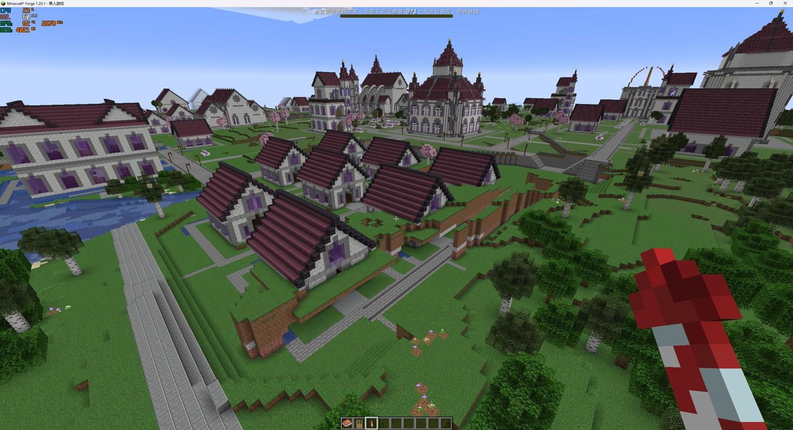
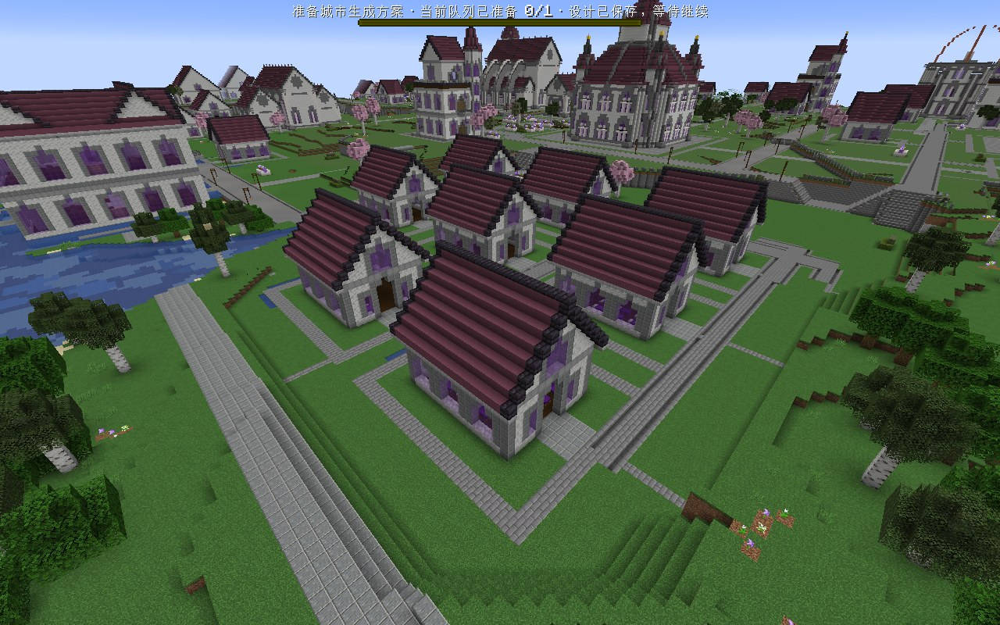
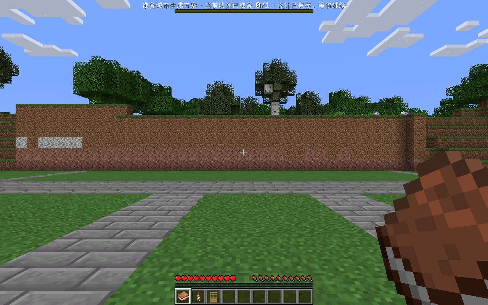
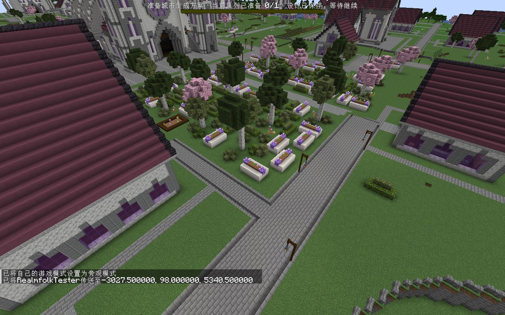
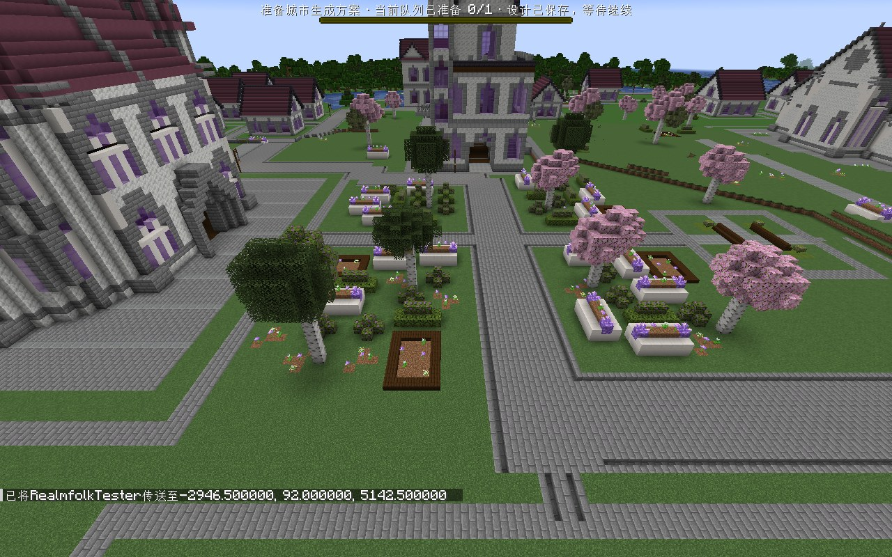

# 第二轮高度关系与宿舍残土修复证据

本页补交 2026-10-18 已有验收资料，本次没有重新运行游戏。实现提交 `2375a427` 已随 PR #13 合入；[任务记录](任务记录.md)保存过程，[高度组合与修复方案](高度组合与修复方案.md)保存用户确认方案。

## 先区分两份副本

| 副本 | 作用 | 结果来源 |
| --- | --- | --- |
| Campus_Height_Round2B | 庭院共台与道路衔接的中间复验；当时仍有宿舍埋土 | [高度摘要](evidence/height-final-result.json)、[实际列](evidence/Campus_Height_Round2B-columns.json) |
| Campus_Residence_Fix | 修复宿舍残土后的最终验收副本；用户认可城市整体观感 | [最终摘要](evidence/residence-final-result.json)、[宿舍扫描](evidence/Campus_Residence_Fix-evidence.json) |

## 关键截图

截图只做等比缩放与 JPEG 压缩；每张小于 500 KB。原文件名、原图及压缩图 SHA-256、尺寸和坐标来源见[图片清单](evidence/image-manifest.json)。无损原图在下方工作流资料包。

### 宿舍区修复前后

修复前用户现场坐标为 (-2743,70,5010)，可见房屋埋土、土墙和悬空残土。

修复后截图前的传送参数为 (-2728,93,4992)，朝向 45/32；取自最终 Campus_Residence_Fix，保留原画面内容，前后并非完全相同相机位置。

### 被测通行与共台复查

宿舍间隙：从 (-2765.5,63,5026.5) 只按前进 60 tick，到 (-2765.5,63,5013.552)，约 12.95 格，生命 20。图为终点，不证明全城所有路线畅通。

教学区复查截图前传送参数 (-3028,98,5340)，朝向 -130/42；书馆复查为 (-2947,92,5142)，朝向 -90/35。两图来自同一最终副本，说明之前共台修复的外观仍保留。

## 数据与验证边界

- [完整冻结计划的边界对照](evidence/actual-edge-comparison.json)：教学、书馆、住宿庭院矩形边界的突变边分别从 140/129/58 降为 0；这是计划对照，不能当作逐列实机扫描。
- [修复前宿舍扫描](evidence/Campus_Height_Round2B-evidence.json)：采样前三栋的非作者自然土石为 318/480/242；[修复后扫描](evidence/Campus_Residence_Fix-evidence.json)覆盖 8 栋，残留均为 0。
- [最终结果](evidence/residence-final-result.json)：842/842 owner 完成，missingOwners 与 failures 均为空。核心 jar SHA-256 与 SurfacePrint 哈希均在摘要中。
- 历史 Java 全量为 1414 项：1399 通过、15 跳过、0 失败/错误。稀疏模板清土 GameTest 通过；跨区块作物/栅栏用例曾两次 UNLOADED，仍待定位。本次仅归档，未重跑测试。
- 最终记录仍报告 917 列过渡约束；本轮未做 NPC 全城寻路和新副本人口发布验收，也未修复无家旅人。不能由截图或 owner 完成数推导这些问题已解决。

## 大附件与复查

[Release 下载](https://github.com/RinsingEL/StructureBinder/releases/tag/experiments/campus-round2-20261018) · [上传清单与 SHA-256](evidence/upload-manifest.json)

- `campus-height-save-20261018.zip`：中间副本 Campus_Height_Round2B。
- `campus-residence-save-20261018.zip`：最终副本 Campus_Residence_Fix。
- `campus-round2-workflow-20261018.zip`：两副本取证 JSON、原图、当前城市 D3—D7/LandUse、Studio 素材、项目 jar、相关配置与第三方模组清单；同时包含护栏原始证据。

各包解压到同一新目录，同名 `instances/height`、`instances/residence` 合并。游戏目录分别为其下 `game/`；Minecraft 1.20.1、Forge 47.4.23，第三方模组按工作流包的 `mod-manifest.json` 配齐。离线分析直接读取各实例 `evidence/` 和本城 `realm_debug`；需要新规划时按本机环境重新配置规划素材路径和服务连接。

存档是补证时本机保留副本的只读快照，用户在取证后继续打开过世界，因此不声明与截图时刻逐字节相同；每包 `package-manifest.json` 记录本次快照时间、范围、逐文件大小与 SHA-256。存档包省略 `realm_debug`、`session.lock`，当前城市流程放在工作流包；未包含全世界调查缓存，不宣称能从零重放全世界规划。启动脚本、服务凭据、账号缓存、运行日志全文和第三方 jar 不分发。
