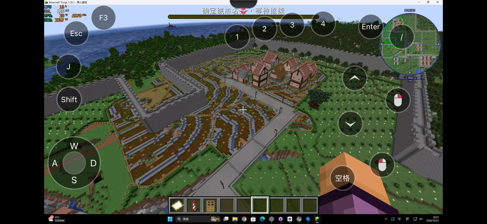
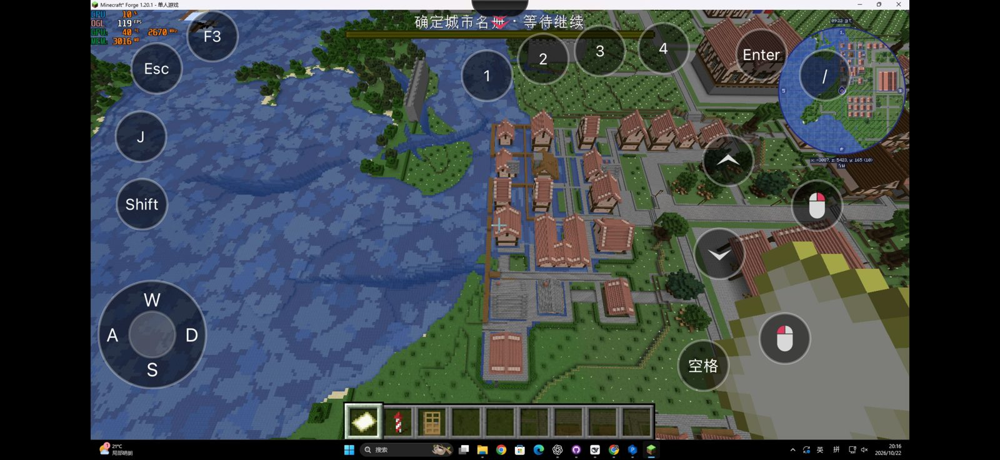
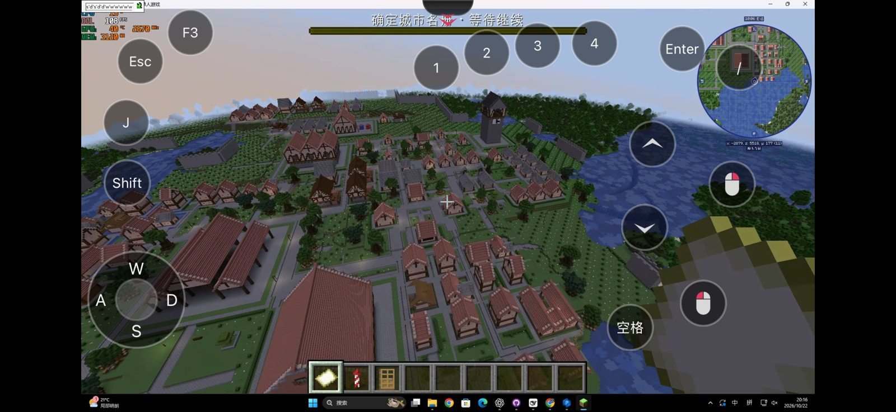

# 同址自由设计 D3 起点 07 · 实机验收简报

日期：2026-10-22  
验收对象：用户指定的 `同址自由设计_D3起点_07` 城市。  
依据：用户实际游玩反馈及提供的七张截图；本报告未新增游戏操作或现场扫描，未独立核验截图对应的运行包版本。

## 总体结论

用户评价“感觉一般般”。农田规模有所增加，但田园分块、滨水街区和城墙整体关系仍不理想，本轮视觉效果未获认可。此前地基取高修复及离线回归通过，不代表城市设计或实机落地效果通过。

## 主要问题

| 项目 | 用户反馈与截图现象 | 初步判断与改进方向 |
| --- | --- | --- |
| 农田 | 面积变大，但变化不明显，仍有台地感；重复窄条田、水渠和石边很突出，农舍集中在较规整的平台上。 | 缺少田间动线及完整农场之间的分块关系，不能只靠降低房屋密度解决。用土路、沟渠、树篱区分大小不同的田块；农舍疏密成组，连接田口、仓棚和进城道路。台地是否由整平造成，待查高度数据。 |
| 港口 | 房屋看起来逐栋漂在水上，排列规整，缺乏沿河岸展开的感觉。 | 现有布局呈现普通住宅网格向水面延伸的观感，连续岸基、装卸前场和岸上街道不清楚。应围绕真实岸线组织“水面—码头—岸边通道—仓库/住宅”，仅让明确的水上设施伸入水面。屋底是否实际悬空，待近景及支撑数据核验。 |
| 城墙 | 墙体切入农田，多处墙段孤立、折返或端头突兀，看不出清晰的围合范围；墙体相对小房屋显得压迫。 | 先查墙线、遇水处理和施工完整性，再调整围合范围、城门与道路、滨水收口及尺度。暂不能仅凭截图认定为规划错误或施工缺段。 |

## 后续顺序

1. 保留当前方案和现场，核查港口建筑支撑、城墙规划与实际生成是否一致。
2. 明确港口岸线布局及城墙保护范围，区分程序问题和设计问题。
3. 调整农田分块、田间路及农舍组合；避免仅增加面积或随机拉散建筑。
4. 改动后用同一地点的俯视和地面近景复验，检查道路可走、岸边承托和墙体衔接。

以上为排查与改进建议，尚未实施，也不构成重画或施工授权。

## 截图依据

从用户原图选取三张压缩留档，坐标为小地图显示的观察位置，不代表问题对象精确坐标。

### 农田与城墙

原图 2，约 x=-3131、z=5024、y=120；展示条带农田、农舍平台及墙体切入关系。

### 港口

原图 3，约 x=-3087、z=5423、y=165；展示水上房屋排列、岸线及连接空间。

### 全城与墙段

原图 6，约 x=-2879、z=5518、y=177；展示整体疏密、大片空地和外围墙段。

