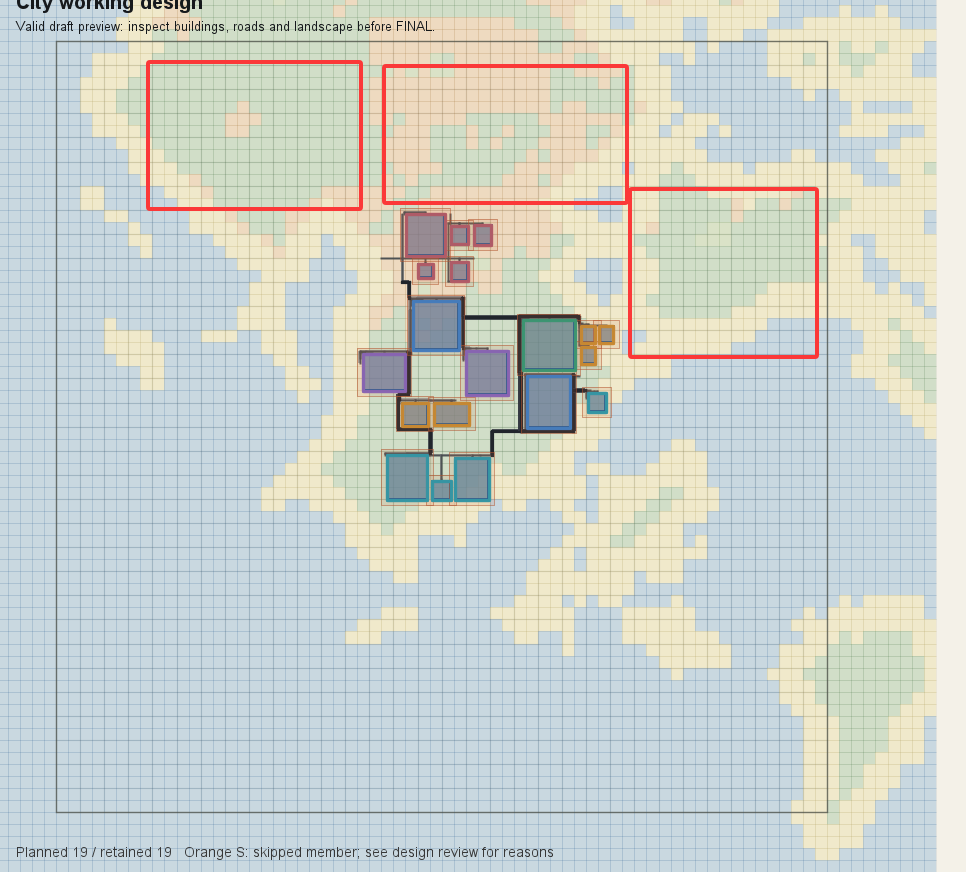
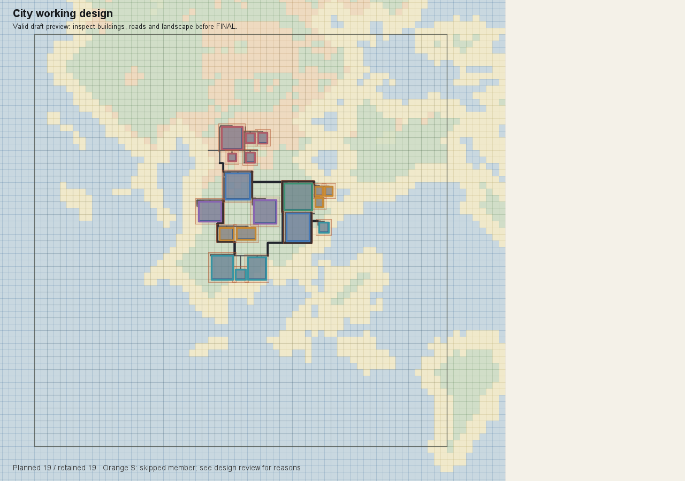
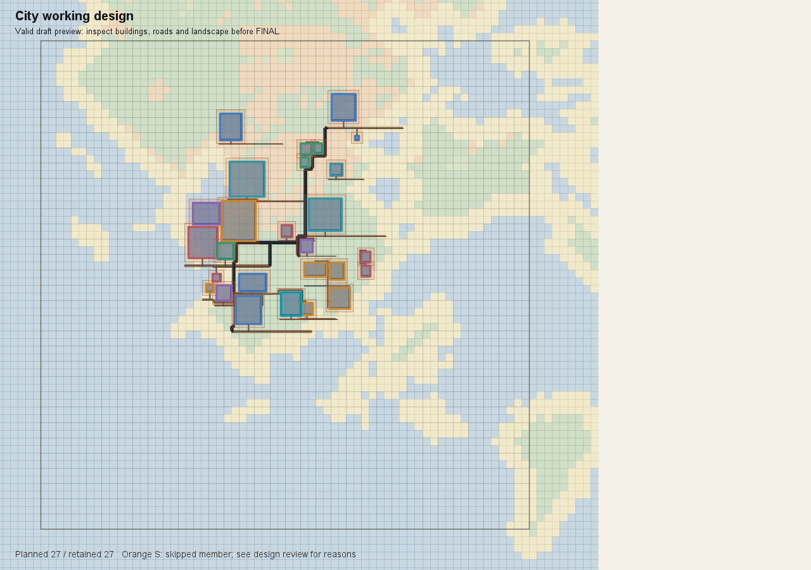
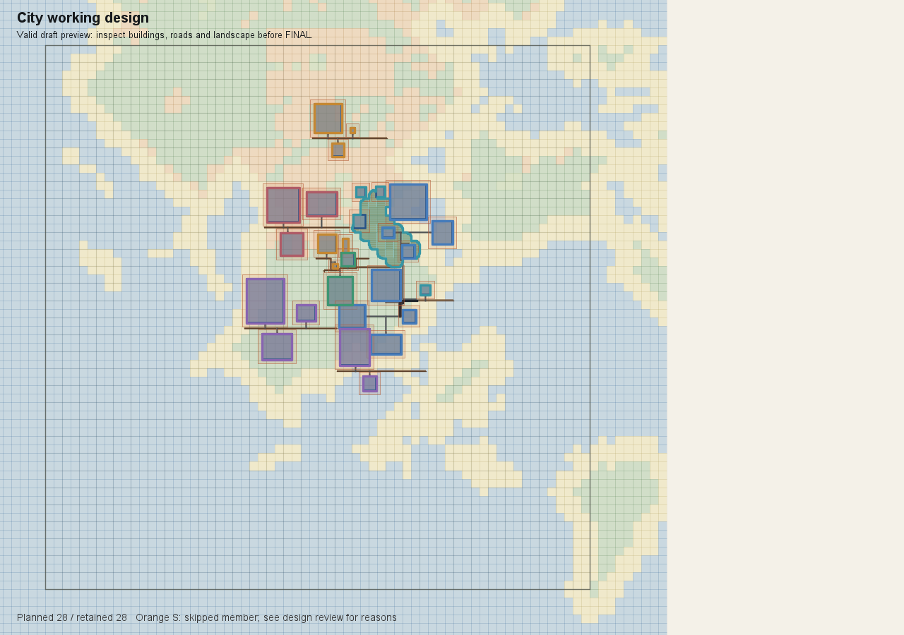

# D4 城市设计验收报告：功能层次、人口与空间规模

验收日期：2026-10-20 · 证据时间：2026-10-19 至 2026-10-20 · 时区：Asia/Shanghai

**验收结论：严重不合格，当前 D4 设计效果不予通过。**

本次问题已经超出个别建筑的位置或数量：设计过程容易把全国唯一学院城压缩为少量大功能标签、几个代表建筑和一套容量对账。功能内部缺乏足够的空间层次，人口示例成为规模锚点，全城预览未有效推动对设计充分性的复核。程序接受蓝图、建筑全部保留，与用户认可城市设计是两项不同结论。

本报告是既有成果的失败验收与证据审查，未重新设计、未运行新一轮游戏验收，也未修改实现。用户明确反对用程序建筑覆盖率门槛迫使填满地图；本报告不建议覆盖率、建筑数、分区数或根锚点数达标即通过。整改方向由总设计 AI 分析后形成方案。

## 1. 验收依据与样本身份

最新依据为[用户原始验收意见](用户原始验收意见.md)。历史产品案中“2026-10-13 D4 合格”是此前版本的阶段判断，不能覆盖本次否决；此前“按人定区”的方向也须接受本次关于过度收缩、过度算数的纠正。

| 样本 | 身份与阶段 | 可核查结果 | 使用边界 |
| --- | --- | --- | --- |
| A：Astra | 聊天“重新设计 D4”；源会话元数据确认 `gpt-6-astra`；context `a2e4d6cf…`；蓝图 `5704a053…` | D4 COMPLETE，workflow revision 10；19/19 栋，4 区；91 常住者、108 床、62 教学座、36 餐座 | 已定稿但未施工，是本报告主要失败样本 |
| B：DeepSeek Flash 较晚轮 | 用户指定模型身份；context `caf6d66b…`；草稿 `aed0d412…` | 27/27 栋，6 区；重置前归档 workflow revision 33，仍为 INTEGRATION | 有正式编译预览；不能写成“D4 已定稿成功”；精确 API 型号未由工作区独立核实 |
| C：DeepSeek 较早轮 | 同一工作区 `design/` 与 `output/`；context `a524a392…`；蓝图 `9c0d449e…` | 旧设计说明及预览为 28/28 栋、6 区，说明记录后续已进入施工 | 仅作历史补充，不能把旧施工状态或旧图套到 B |

A、B 的 D3 内容哈希均为 `96ef0c3c…`，目录快照内容哈希均为 `228d0a50…`，具备比较地形与素材条件的基础；不同 context、执行时间、调试重置和工具环境仍使其不构成严格的模型能力对照实验。用户称已试过四个模型，本报告只核对所提供的两类模型证据，不把另两轮写成已复核事实。

完整哈希、分区与人口见[样本汇总](evidence/derived/sample_summary.json)，源文件位置和校验值见[来源清单](evidence/来源清单.json)。

## 2. 主要验收失败项

| 项目 | 本次判断 | 直接证据 | 影响 |
| --- | --- | --- | --- |
| 功能层次与城市职责 | 不通过 | A 的教学、文献、院务集中在一个 5 栋组团；观象、实验、植物教学集中在另一个 5 栋组团。B 分得更细，但仍以各类代表设施为主 | 大功能没有展开成可探索、可区分的学部、教学楼群、院务空间、阅读自习区及配套层次 |
| 人口与规模的关系 | 不通过 | A、B 都写入 60 名学生；A 围绕 95→91 人、三食堂→一食堂、50→62 教学座修订；B 人口口径互相冲突 | 用小规模假设反过来证明少量建筑“已经足够”，公共与居住缺少主动发展的空间 |
| 场地利用与停止依据 | 不通过 | A 用户圈出的三片主要区域未获逐片评估；停止理由是“继续扩张会占用保留林地而无必要” | 缺少全场地的功能选择、发展潜力与保留依据，局部能落位代替了城市是否设计充分 |
| 从预览得到设计反馈 | 不通过 | A 确实看图、移动生活区避湾；B 也有连续编译图。但没有形成相应的全城功能与规模重构 | 问题是看图后的判断与行动，不宜简单归结为“没有看预览” |
| 程序可行性 | 与效果分开记录 | A、B `compilationAcceptance.passed=true`，同时 `qualityFullySatisfied=false`；B 尚有连通诊断问题 | “通过”“全部保留”不足以证明城市设计合格，质量诊断也不应机械清零 |

### 2.1 大功能标签没有展开为城市内部层级

A 最终只有学术中心、生活、迎客、研究园艺四个区，实际分配如下。数量用于描述样本，不是新的验收指标。

| A 分区 | 实际内容 | 保留建筑数 |
| --- | --- | ---: |
| academic | 藏书馆、庭院教学楼、议事楼、小课堂与教学翼楼 | 5 |
| commons | 主宿舍、3 栋小宿舍、食堂、洗浴 | 6 |
| arrival | 水运接驳、日用品、仓储 | 3 |
| fieldwork | 观象、双实验教学、温室与药草试种 | 5 |

这说明方案并非完全没有功能，但功能主要体现在建筑清单和用途文本里。全城没有继续展开出多个有自身服务对象、活动和空间组织的教学子区或生活街坊。源数据见 [A workflow](evidence/astra/city_d4_workflow.json) 与[编译结果摘录](evidence/astra/compiled_layout_excerpt.json)。

B 有迎客、主院、藏阅、观象、生活、园圃六区，较 A 多出独立藏阅等层次；因此不能笼统写成“两者都只有教学、生活、种植三个区”。但它的 20 个建筑组中，15 组仅保留 1 栋，5 组保留 2～3 栋，且没有嵌套组合。增加建筑组 ID 并没有形成用户期望的多层功能片区；北部观测与仓房等在图上仍呈单点分布。见 [B 编译结果](evidence/deepseek_latest/compiled_layout_excerpt.json)。

用户提出的“学部、教学楼群、行政楼、阅读自习区”等，是要求思考活动和内部组织，不是要求每个名词都单独造一个功能区、放一栋楼，也不是要求给原来几个区换更细的名字。一个大功能片区应能包含若干有联系的子区；每个实际阵列区仍可保留一个核心。

### 2.2 人口算式提前锁住了城市规模

A 的总览先设“60 名学生 + 约 35 名教职服务人员 = 95 人”；最终改为 60 + 31 = 91 人。手册示例也使用 60 名学生，A 在用户追问后明确承认没有独立论证为何采用这一规模。B 的总览同样写“服务 60 名学生”，沿用了示例中的教师 8、院务 2 等数字。它们与示例一致是事实；示例导致锚定是有证据支持的解释，不是受控实验已证明的唯一原因。

A 的后续修订中，查明 3 栋小食堂只有 18 座后，换成 1 栋 36 座主食堂，并把餐饮岗位从 6 改成 2；最终据此把全城人口从 95 调到 91。教学座位由 50 补到 62 后，又以“足够 60 名学生”支持完成。这些容量核查本身有价值，但主导了已经很小的空间方案，未回答全国唯一学院城需要哪些学部、办学层次和公共生活。

B 的[归档 workflow](evidence/deepseek_latest/city_d4_workflow.json)还显示：各区岗位相加为 41，加 60 学生应为 101；居住却填写 92 人。purpose 同时写“92 床、92 人、入住率约 0.85”，三者不一致。这是设计记录内部的算术矛盾，并不意味着应该继续为精确入住率反复修改城市。它说明数字工作既占据了设计注意力，也没有稳定形成一致口径。

整改应保留岗位、床位、公共容量的基本可信度，同时允许人口规模随着工作功能展开而增大，允许更充分的公共和居住空间、不同居民构成及合理余量。不能把“按人定区”执行成先选一个低人口，再反向压缩全城。

### 2.3 主要土地没有得到充分的设计论证

图 1：用户在 A 的 D4 图上圈出西北、北部与东北三片区域。图中城市主体位于中南部。红框是需要分析的空间，不是已经完成地形工程校验的建设用地；不能直接把整个红框面积当作可建面积。

A 的最终自评写：“当前规模承载本城全部核心职责，继续扩张会占用保留林地而无必要，故停止。”用户指出三块地后，A 才承认此前没有证据证明它们不能用。问题在于保留理由没有与完整的功能构思、其他布局选择和主要地块条件逐项对应。

D3 已提供地形和场地信息；最新两个样本共享该输入。图上可见的林地、平地或台地应进入设计判断：哪些可以承接新的学部或住宅街坊，哪些应保留，为什么；受水体、高差、采样范围或素材尺寸限制的部分，应指出具体限制。既不要求把岛填满，也不能仅用“紧凑”“保留林地”概括所有未设计区域。见 [D3 原始资料](evidence/shared/city_landform_review_package.json)及[选址复核](evidence/shared/city_site_review_decision.json)。

### 2.4 看过预览，但完成判断仍偏向局部可行

图 2：A 定稿对应全城预览，19/19 栋；实际建筑范围 X=-3033～-2701、Z=5110～5488。范围只描述最外侧建筑，不表示其包围的土地都已设计或可用。图上可以看到中央院落、东侧生活和南北端组团；仍缺少用户期望的大功能片区内部层次。

图 3：B 重置前的 27/27 栋草稿。实际建筑范围 X=-3131～-2750、Z=4992～5473；跨度大于 A，但更大的外包范围不等于更充分的城市。20 个根建筑组、较多单体与道路支线没有自然构成多个清楚的子功能片区。

A 的 review 保存了已查看全城与局部图的标识，后期还整体北移生活街坊 75 格，以避开东南水湾。B 的工作区保留多次迭代图。这些是有效动作，应保留正面事实。失败发生在更高一层：没有用全城图重新检查“功能是否展开够了、主要空间是否经过选择、公共与居住是否足以形成城市体验”。

B 的程序诊断仍包含道路连接不可用、结构关系图不连通、门楼到主厅 CONNECTION 未满足、根组过多等提示；`passed=true` 只表示当前接受策略允许该编译结果，不应表述为效果验收通过。A 虽然结构图连通，也存在局部道路与根组诊断。报告不要求把警告变成硬门槛；总设计须判断哪些警告指向真实体验缺陷。

## 3. 设计过程的可核查时间线

以下取自 A 的实际工具事件时间，均为 2026-10-19 本地时间，不含此前重置接口阻塞。

| 时间 | 实际动作 | 说明 |
| --- | --- | --- |
| 23:37:23 | 提交总览 | 已给出 4 大区、60 学生、95 人、108 床 |
| 23:41:44 | 第 4 区初版提交 | 从总览到四区提交约 4 分 21 秒 |
| 23:42:13 | 生活区向教学区靠近 | 一次实际空间关系调整 |
| 23:44:25 | 3 小食堂改 1 主食堂，95→91 人 | 容量核查与局部布局修订 |
| 23:45:15、23:45:30 | 教学补到 62 座，并提交公共空间设计 | 两次被公共空间坐标误拒绝阻塞 |
| 23:45:55～23:46:30 | 修正院落阵列参数并改为嵌套围院 | 同时有格式纠正与空间修订 |
| 23:47:54 | 生活区北移 75 格避水湾 | 局部地形调整 |
| 23:48:53 | 保存定稿 | 四区初版后约 7 分 08 秒 |

用户感受到“初版很快，后面大量时间钻人数”有明确行为依据，但不能把后续这 7 分钟全部记为人口计算；其中还包括校验器 Bug、参数纠正、看图与避水调整。B 缺少同等完整的聊天时间线，本报告不比较两模型的耗时或推理效率。原始可审查事件见 [A 工具时间线](evidence/astra/tool_timeline.json)，提交参数见[设计提交记录](evidence/astra/design_submissions.json)。

## 4. 原因核查：事实与待验证解释

| 因素 | 已确认事实 | 需要总设计判断的影响 |
| --- | --- | --- |
| 子功能指引弱化或缺席 | A 实际返回手册与 B 较晚轮保存手册去换行后内容一致，均没有“子功能”字样。B 旧版手册的“子功能”位于素材查询与标签分类说明 | 不能仅归结为 Agent 无视了明确的子区设计步骤；需检查“功能拆分”在实际运行输入中是否存在、位置是否足够明确 |
| 同类片区与阵列合并的表达冲突 | 产品案明确“多个同类区相邻，形成更大的功能片区”；手册强调“一个或极少数根组合”“同类小建筑放进同一个阵列”，还给出第二根通常净距不超过 30 格 | 这些话可能混淆城市片区、具体功能区与阵列层级，使避免碎片化变成不敢发展多个同类子区；不是断言单核心机制本身必须废除 |
| 示例比职责更具体 | 手册写出 60 学生、93 人、入住率 0.85、食堂约三分之一；两轮均采用 60 学生 | 数字易被当作目标而非教学示例；宜检查示例怎样呈现、人口何时确定、哪些值只是估算 |
| 上游已有收缩语言 | citySeed 写“紧凑学院城”“保留林地”“按真实可建面积取舍核心建筑”；手册又强调少根、同类合并、空地不是扩展理由 | 多层输入共同提供收缩方向，而充分展开功能和生活的指导较弱；不能仅修改最终提示中的一句“大胆设计” |
| 总览锁定与修订粒度 | 首个有效分区后总览锁定；后续以完整替换某区、保持其他区为主要接口，扩张有受控范围 | 初版分类较粗时，重构全城功能层级的成本可能偏高；需检查能否保留成果同时重新划分职责与骨架，尚未证明这是唯一根因 |
| 自评接受不足以说明充分性 | A 用小人口、容量达标和“职责已有承载”完成自评并定稿；B 同样反复尝试以全部保留支持结束，但最新归档尚未定稿 | 需要改进看图后应交代的设计判断，而非增加面积百分比或数量门槛 |
| 公共空间实现缺陷 | 通用禁字段检查漏掉 publicRealm 合法坐标，A 的 origin.x 和 entries[0].x 被拒绝 | 是公共空间构图落空的独立阻塞，确实增加试错；不能解释为何在它发生之前就只设计四大区 |

提示词证据在 [A 实收手册](evidence/prompts/astra_received_handbook.md)、[B 较晚轮手册](evidence/prompts/deepseek_latest_handbook_raw.md)、[B 较早轮手册](evidence/prompts/deepseek_earlier_handbook.md)、[产品案快照](evidence/prompts/产品案_按功能区设计城市_快照.md)及同目录的阶段提示快照。A 在事后聊天中的自我解释也保留在[公开消息](evidence/astra/public_messages.json)，它是辅助材料，不替代上述直接证据。

## 5. 交给总设计 AI 的整改议题与复验要求

建议先形成设计与流程修订案，再决定必要的接口和实现调整，不直接把本报告的建议写成新硬规则。

1. **明确空间层级。** 区分“大功能片区—有自身活动的子区—建筑组/院落—建筑”。教学可以展开为不同学部、公共教学、院务、阅读自习、研究实践与支持空间；是否分开、相邻或共享，应由本城职责和场地决定。避免一功能一栋楼，也避免每个用途词都强制拆区。
2. **调整人口的角色与时机。** 先把工作职责和服务对象展开，允许采用有理由的规模范围；随空间方案增加工作、公共和居住承载，再集中核对床位、岗位与容量。入住率与餐座比例作为估算参考，不把示例人数或精确算式当作城市上限。不能靠下调人口掩盖设计不足。
3. **让全场地参与构思。** 在全城预览与 D3 条件上说明主要片区的利用、保留和限制，比较必要的扩展选择。用户圈出的三块地应有明确分析；合理林带与水湾可以保留，但保留须有具体理由。
4. **让看图改变设计。** 最终说明应交代哪些职责或活动曾缺失、如何落成可识别的子区，主要公共空间与生活空间为何充分，是否仍有只靠长路挂接的单体。不能仅罗列保留数量、连通布尔值和人口算式。
5. **处理流程与实现阻塞。** 核对同类区扩展和全城重构的入口；修复公共空间坐标误拒绝。修复 Bug 后仍需独立复验设计充分性，不能以工具恢复可用视为验收关闭。

复验应继续使用可对照的 D3 与素材快照，保存模型实际收到的指引、总览、分区修订、最终自评和全城/局部图，并由用户或独立审查者判断体验。通过依据应包含：功能拆分具有空间表现；工作、公共、居住形成足够的城市生活；主要场地选择有理由；整体连续且有层次；人口核对支撑方案而不反客为主。**不设建筑覆盖率、最低建筑数、最低子区数，也不要求把所有空地填满。**

## 6. 适合移交的材料与排除项

本包优先提供四类证据：用户原话和圈图、两个最新样本的正式预览与设计参数、实际实收提示词、设计动作与停止理由。它们足以让总设计 AI 追踪“输入怎样引导、Agent 怎样设计、为什么停止、用户为何否决”。

较早的 28 栋轮只保留旧说明、定稿参数和总览图，单独放在 `deepseek_earlier`，避免污染最新结论。旧轮施工截图、D7 故障资料不适合作为本次 D4 设计质量的主证据。

图 4：C，28/28 栋。版本不同于图 3，不能用它证明 B 已完成或已经施工。

不打包完整存档、jar、整份会话运行日志、重复大 Context、客户端脚本或会话凭据。完整存档与施工数据仅在后续工程复现需要时再另行提供；本包保留来源和哈希以便追溯。导出的会话材料只含公开消息和工具事件，没有内部推理内容。

详见[移交入口与阅读顺序](README.md)。报告与选定证据随本轮提交归档入库，供总设计 AI 直接阅读；没有向其他聊天发送消息，也没有把验收问题标为已修复。PR 是否合并另以仓库状态为准。
