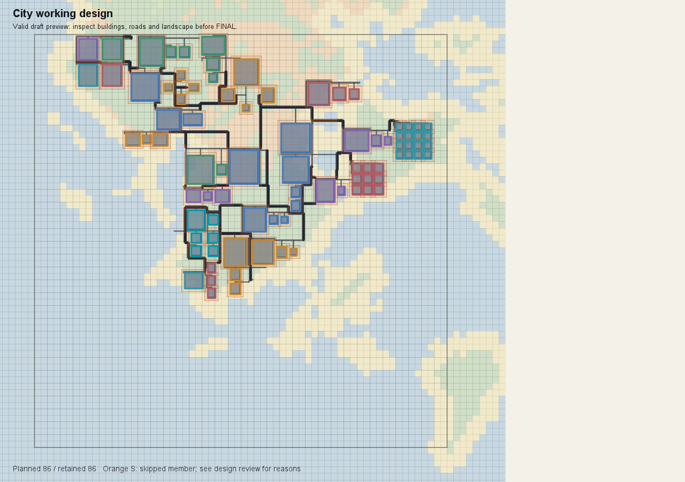
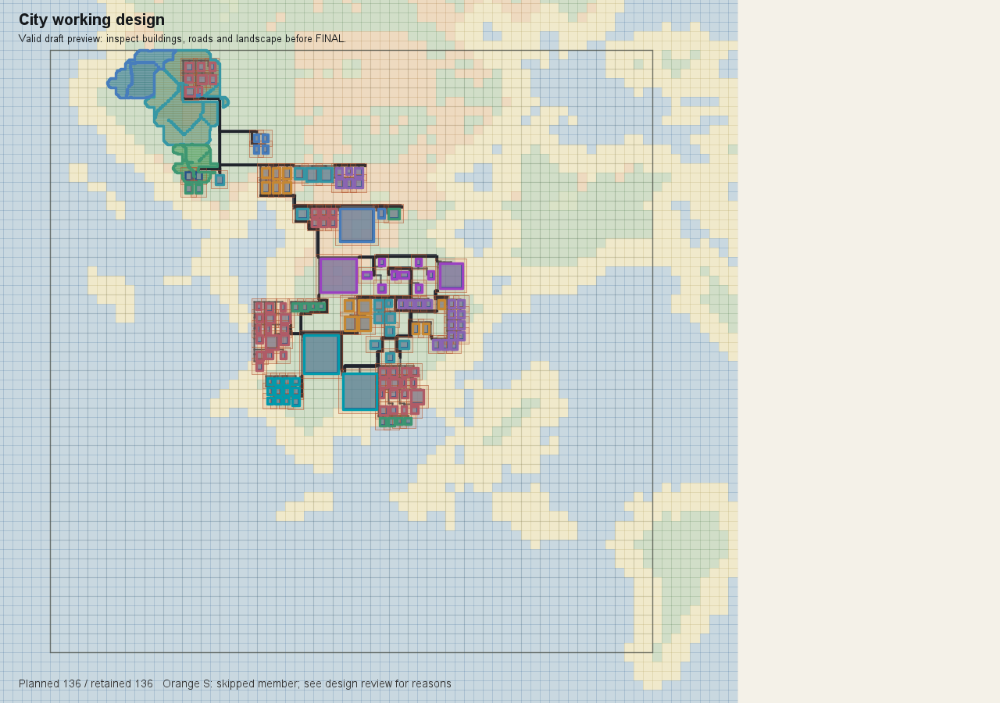

# D4 城市设计三会话复盘与提示词调优建议

2026-10-22 · 给小克的交接报告

**结论：保留现有设计自由，优先消除提示与接口的矛盾，不为低遵循能力增加全局约束。** Astra 和 Sol 已证明，这套手册能支持较好的空间设计。DeepSeek 的失败既暴露了公共接口问题，也包含明确的素材误选、用途误读和事后归因错误；后者不能一律转化成提示词改造需求。

用户最新边界：**“如果是模型能力的话就不管了，我们不能因为模型指令遵循问题而去限制更成熟的模型的创造力。”** 本报告据此筛选建议。Astra 被用户称为“模板中的模板”，这里按优秀范例理解，不解释为用户在批评同质化。

本次读取顺序为 Astra → Sol → DeepSeek，各会话先回看最后结果和用户反馈，再回溯实际调用。已核对原始日志、冻结上下文和部署凭证；没有重跑游戏，也没有修改提示词。短证据及完整指纹见[证据与版本核对](证据与版本核对.md)。

## 1. 三轮究竟完成了什么

| 样本 | 实际任务与素材 | 可核实结果 | 用户评价与完成边界 |
| --- | --- | --- | --- |
| GPT-6 Astra / medium | 清空 D4，保留 D3；唯一学院城，使用“魔法学院新制” | 16 子区、86 个计划/保留单元；设计保存。后续另一轮推进，86 个建筑及种植单元落地 | 用户认为可作为优秀样板。施工仍有 5 条区块加载失败记录；不称零错误验收 |
| GPT-6.1 Sol / medium | 同址自由选择职责；用户选“欧洲中世纪新制” | 10 子区、136 计划/保留单元；D4 保存 | 用户认为及格以上。后续被 `CITY_FOUNDATION_ELEVATION_UNAVAILABLE` 阻断，所附图片为规划平面图 |
| deepseek-account / deepseek-flash / max | 用户要求做到 D4 完成即停止；起初要求新制学院，后自行转为旧“魔法学院” | 首版 7 子区、14 单元，后增至 16；最终仍处于核心返工，未完成 D4 定稿 | 用户评价差。日志不能支持“已施工完成后效果差”，更准确是设计阶段已暴露问题 |

这些数值用于复原过程，**不是设计质量排名或最低规模标准**。86 中包含 25 个种植育苗单元；136 中也有重复农林单元。楼数不能直接比较职责、空间层次或美感。[A、S、D]

## 2. 同地形成立，同版本不能一概而论

- **三轮 D3 内容 hash 相同**，可确认共享冻结地形基础。
- **Sol 与 DeepSeek 的完整素材快照 hash、实际返回 handbook 原文 hash 相同。** 两者的任务主题不同，但手册差异不能解释这两轮的主要落差。
- **Astra 的完整素材快照不同。** Astra 的冻结 handbook 主体与后两轮一致；统一换行后，后两轮仅在末尾增加“乡野片区与地形线”章节。
- 进一步限定到本案相关素材，**Astra 与 DeepSeek 的 45 个新制学院 ref、冻结模板 hash、作者功能/风格/地形标签均一致**；语义条目只差溯源字段。不能用完整目录 hash 不同解释 DeepSeek 对学院能力的误判。
- 10 月 20 日与 21 日的部署回执记录了不同 JAR hash，素材总目录从 527 项扩到 602 项。没有三场 JVM 启动时的完整制品指纹，因此不能宣称三场二进制完全相同，也不能仅凭当前 JAR 倒推历史。
- Astra/DeepSeek 保留学院职责，Sol 则获准重新决定城市主题和功能。这不是严格控制了所有输入的模型对照实验。

这些差异不妨碍对照具体行为：**总览前的素材查询被拒，在三个样本里都出现过；好模型找到兜底路径，差样本未有效恢复。** 这是比笼统讨论“哪个模型会设计”更可操作的公共问题。[V、A、S、D]

## 3. Astra 值得保留的是判断方式

Astra 在声明总览前尝试按“魔法学院新制”查询，被接口拒绝后，从已返回的冻结目录抽出 `mg-*` 作者语义条目，再列出 16 个子区。教学、文献、观测、实验、生活、种植和后勤分别落实到空间用途；不是从一个既定人口数字反推需要几栋楼。

这轮最有价值的部分，是**具体观察引起了具体修改**：

| 观察到的问题 | 实际修改 | 可复用的判断 |
| --- | --- | --- |
| 南宿院请求四栋，实际仅出现一栋 | 先调整停止条件，未解决后改核心与配套组合，保留四栋目标 | 关注原设计是否表达出来，不只看工具成功或最终“计划全保留” |
| 教师住宅重复填充只生成两户 | 改为四个显式住宅成员，由同一个根组合组织 | 同一设计目标允许换一种合法表达 |
| 南宿院两条主路未接通 | 平移无效后，重组为自带庭院宿舍与生活巷，打开通勤口 | 修空间关系，不靠删除必要连接消除告警 |
| 北部住学区到南端食堂距离长 | 保留宿舍，增加就近食堂与小餐厅 | 在全城尺度复核日常生活；容量用于检查空间方案 |
| 庭院、根数组合等诊断未全绿 | 对实际连接、庭院用途、水面保留逐项说明，保留剩余限制 | 不把启发式告警全部升级成设计禁令 |

这些可以作为小克理解“好设计决策”的案例，**不应改写为所有城市必走的检查表、固定子区或必用布局**。例如南北食堂是这座城市的通勤判断，不是今后每城必须有两个食堂。Astra 也有中心重复列入组合、四边院落成员不合法、预览参数互斥等普通输入错误，不能把全部返工美化为设计能力。[A]

图注：原会话保存的 86/86 设计图。只展示二维布局，非本次新拍的游戏验收画面。

## 4. Sol 是另一条有效路径，不必向 Astra 的耗时看齐

Sol 同样在总览前遇到素材接口限制，但从冻结目录提取了欧洲中世纪新制的 73 条功能摘要及尺寸，再提交 10 区总览。它没有照搬学院的职责列表，也考虑了素材体量：用小型礼仪模板承担静院，避免与市政主体争夺地位。

最强的可观察证据有两处：

- **市场核心实际为 0，工具却已接受本区。** Sol 读取保留明细，确认核心与市政厅碰撞；市场组合沿主轴南移 120 格后，核心、商会和 12 个商铺全部保留。
- **西侧临街店居缺失。** Sol 保留原 16+4 数量和素材，只把组合对齐由 CENTER 改为 START，恢复缺项。

它还发现铁匠请求 6 栋却只编译 1 栋，尝试补组后仍只有两栋实际铁匠，并在定稿说明中承认限制。这说明“136 计划、136 保留”并不能表示原始请求全部实现；请求数、编译计划数、保留数是三种不同口径。

Sol 的信息读取也不宜照搬：它多次输出过大的 Context/referenceCatalog，发生截断；成功的功能摘要与多余的大目录输出要分开评价。少一次手册调用、多一次预览调用也不能直接作为好坏标准，部分工具返回本身已附图。[S]

图注：136/136 的已保存方案；后续地基错误阻断施工。

## 5. DeepSeek 的问题应当分责

### 可以归为模型执行能力的问题，本轮不靠追加规则处理

1. **混淆旧、新学院系列。** 最初 citySeed 指定新制学院；它先选旧 `aa-*`，收到作者风格与回答不一致的报错后，把全城 profile 改成旧学院。随后所谓“学院没有码头、食堂、观测等素材”的盘点，实际上只看了旧 53 条；冻结目录中的新制 45 条已有水运接驳/候船、餐饮/集体用餐、天象观测、仓储等作者用途。不能据此要求建模者补做已经存在的功能。
2. **名称代替功能证据。** 把 `aa-08-v01`（药材配制、零售）提交为长桌食堂/公共餐厨，把 `aa-10-v01`（晶石加工）作为观测核心。现有规则已要求遵循作者用途，此处是违反现有约束，不是缺少一条“药铺不能当食堂”的新规则。
3. **截取不全后推断不存在。** 只读取 432 个池的前 135 个，就误认没有学院填充池；用户质疑后才在 349 之后找到。这属于检索与证据处理能力问题。接口可少返回冗余信息，但不能替模型对不完整读取作错误推断负责。
4. **事后提出凑数规则。** “每区至少 3/5 个素材”“全城不足 30/40 栋即失败”均没有证明，且偏离有限模板结合地形设计不同城市的目标。本轮不采纳。

需要公平补充：DeepSeek 确实在总览前读过手册，也尝试过素材查询；不能写成“根本没读”。它也修过药草建筑缺失，不能写成“从不修复”。关键差别是查询失败后，没有像另外两轮那样恢复目标风格的功能依据，后续还改变主题、误读用途。[D]

### 确实属于共享提示或接口的问题

| 问题 | 证据与影响 | 建议边界 |
| --- | --- | --- |
| 总览前查素材却要求先声明功能区 | 三轮都有被拒记录；模型只能从巨量 Context 兜底 | 提供可选的、合法的风格功能摘要入口，不增加“必须先交盘点表”的阶段 |
| “总览锁定”说明不精确 | Sol/DeepSeek 的 handbook 说首区后锁定，动态规则却允许增补区、拆分未设计区 | 同步真实可改范围，减少过度预规划和误判必须推倒重来 |
| 错误信息与最小合法输入不易获得 | DeepSeek 首区 16 次尝试涉及多种错误，部分数值错误被包装成 WEIGHT_INVALID；Astra 遇到示例坐标被校验拒绝 | 清楚暴露字段、合法示例和失败位置；程序缺陷由程序修，不能靠一长串提示绕过 |
| 返回体过大，关键差异不突出 | 两个较好模型也有巨量输出；requested/planned/retained 容易被“全部保留”掩盖 | 返回短摘要与按需详情，减少重复上下文，不新增数量质量门槛 |

“总览锁定”误判同时有两个因素：文字确实冲突，DeepSeek 也没有正确使用同轮更具体的规则。修文字的理由是消除所有模型的歧义，不是要为一次漏读建立更多限制。

## 6. 耗时：约三倍属实，不能全算设计收益

| 口径 | Astra | Sol | DeepSeek |
| --- | ---:| ---:| ---:|
| 对应设计活动耗时 | 46 分 04 秒，含连接、重置、保存收尾 | 15 分 19 秒，含 D3 复核、D4 和阻塞检查 | 初次设计及必要用户纠错回合合计 17 分 12 秒；含后续纠偏与功能盘点共 19 分 53 秒 |
| 工具口径 | 106 次结构化 MCP | 56 次结构化 MCP | 后一口径为 100 次各类工具调用，含终端/文件工具，不能直接当 MCP 比较 |
| 分区提交 | 28 次 / 16 区 | 15 次 / 10 区 | 28 次 / 7 区，含多次首区失败 |
| 结果 | D4 保存 | D4 保存 | 未定稿 |

Astra/Sol 整轮墙钟约 **3.01 倍**，MCP 调用约 **1.89 倍**。两者累计 MCP 工具时长分别约 147 秒和 120 秒；工具运行时间本身不足以解释约 31 分钟差距。剩余时间混合模型生成、上下文处理、脚本编排等，不能直接命名为“纯思考时间”。

Astra 从总览接受到 16 区初版齐约 29 分 36 秒，之后到定稿约 12 分 44 秒；Sol 对应约 9 分 28 秒和 2 分 29 秒。Astra 多做了若干确有收益的生活与交通修订，也有无效输入、公共空间接口返工和更密集的逐区材料确认。应当压缩后者，不能直接用统一时间上限砍掉前者。

DeepSeek 的回合间用户等待、早期 DSH 配置争议、末尾复盘讨论未混入以上设计耗时。三轮主题、区数和工具环境不同，这些是本次观察值，不是模型速度基准。[T]

## 7. 建议给小克的实际修改范围

**第一优先：两处文字和入口对齐。**

1. 同步 `handbook.md`、`overview.md` 与动态 submissionRules，准确说明哪些设置冻结、哪些区仍可补充或局部修订。不要再要求首次总览必须穷举所有子区。
2. 让模型在没有功能区 ID 时也能按目标风格查看简要的功能覆盖、模板尺寸范围及少量代表 ref。详细选材仍按需查询；摘要用于支持构思，不固定设计顺序，不要求把标签逐个变成子区。

**第二优先：缩短反馈，不扩大门禁。**

3. 每次编译优先返回本次变化：核心/必需项缺失、请求→计划→保留的差异、具体碰撞或未接通对象、当前可做的操作；完整目录、几何、诊断仍可展开。不要把所有返回数据反复灌进上下文。
4. 整理工具示例与校验的真实冲突，给出具体字段及可用值。已修复的历史公共空间坐标问题标为历史，不重复提成待开发；真实地基错误、数量折叠等另走程序问题，不让提示词承担修复。

可考虑的简短手册替换文字（**仅供小克评估，未写入产品**）：

> 构思可以在城市职责、场地和当前风格素材之间往返。需要了解素材能力时，可先查看该风格的功能与尺寸摘要，再按具体设计查候选；不必提前选完全部建筑，也不按标签或模板数量机械分区。
>
> 首个功能区保存后，全城设置与已保存区定义保持稳定；在当前工具允许的范围内，仍可增补子区、拆分尚未设计的区，或定向修订已保存方案。具体范围以本轮 submissionRules 为准。

这两段解决的是信息入口和可修改范围，不规定一座城市应长成什么样。若素材摘要入口尚未实现，不应先把不存在的查询能力写进手册。

**本轮明确不建议新增：** 每区/全城最低楼数、最低素材数、覆盖率门槛、必须全绿、强制功能矩阵、固定子区清单、统一修订轮数或时间上限。也不因这一份 DeepSeek 样本重写“作者用途”“风格遵循”等已有要求。单轴、中心、地标示例是否要泛化，需要独立的跨主题证据；本次没有证明它们是失败主因。

## 8. 如何判断这次调优值得保留

在同一冻结 D3、同一素材快照、同一实际提示词/工具版本下，让成熟模型继续自由完成不同主题。比较的是：是否更容易查到有用素材，是否少了契约返工和重复大目录，是否还能作出具体的功能、空间和生活判断。

审查时分别记录 D4 保存、后续施工和游戏视觉验收。设计质量以实际图面、职责与生活关系判断，耗时作为成本记录；不要为了让较弱模型通过而降低成熟模型的表达上限，也不要用楼数上涨代替进步。

可作为正向案例保留的，是 Astra 的宿院/通勤/就近餐饮判断，以及 Sol 的市场与店居修订。它们是“为何这样改”的例子，不是以后城市的统一模板。

---

附件：[证据与版本核对](证据与版本核对.md)。本报告只提出调优建议；本轮经用户另行授权完成的乡野职责文档清理，与上述提示词调优相互独立。调研没有修改提示词、游戏配置或存档。本报告与配套证据经用户授权纳入 Git；需求案清理改动不包含在本报告提交中。
