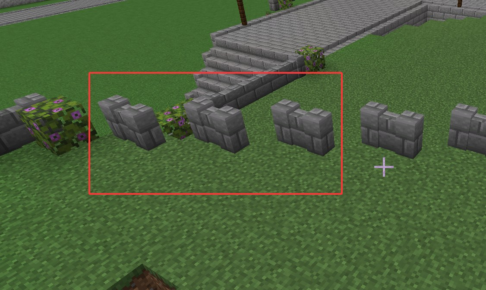
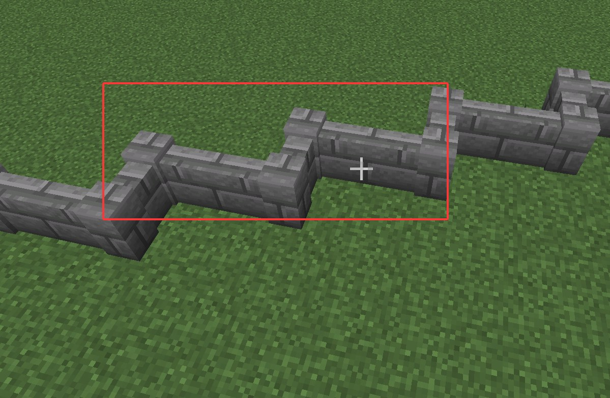

# 台地护栏连续性修复证据

实现提交 `a4cdacad` 已随 PR #13 合入；[任务记录](任务记录.md)保留自动回归结果。以下两图是用户的问题和期望，**没有护栏自动修复后的实机截图**；当时用户要求跳过实机复验，本次也未启动游戏。

## 用户截图

原记录未提供拍摄坐标，不补猜坐标；原图与压缩图的 SHA-256 见[图片清单](evidence/image-manifest.json)。

第二张是用户手工搭出的连续折线护栏，不能作为程序修复通过的证据。

## 自动验证与待实机范围

- [旧计划候选转角](evidence/old-plan-corner-candidates.json)：151 处候选，尚需排除构筑物占用；原始数据的 surfaceHash 为 null，按原样保留，不伪补哈希。候选数不是实际落盘通过数。
- 历史回归覆盖四方向斜边、道路/楼梯/构筑物开口、两类护栏、反向 owner 顺序和内部护栏抑制。合法用例在旧基线 11 项中 3 项失败，修复后通过。
- 历史 Java 全量 1417 项：1402 通过、15 跳过、0 失败/错误，jar/reobfJar 成功；本次归档未重新运行测试。
- 修复后的护栏仍待实机抽查；此前 GameTest 跨区块 UNLOADED 仍另案保留。

[Release 原图与完整数据](https://github.com/RinsingEL/StructureBinder/releases/tag/experiments/campus-round2-20261018)中的 `campus-round2-workflow-20261018.zip` 保存原图和原始计划数据，见[上传清单](../2375a427_v0.2.0_学院第二轮高度关系修复/evidence/upload-manifest.json)。两张仓库图均小于 500 KB，原图未覆盖。
