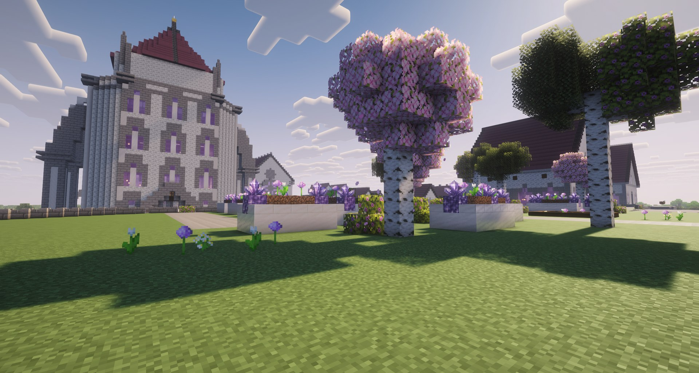
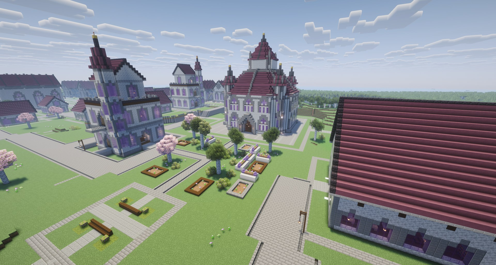
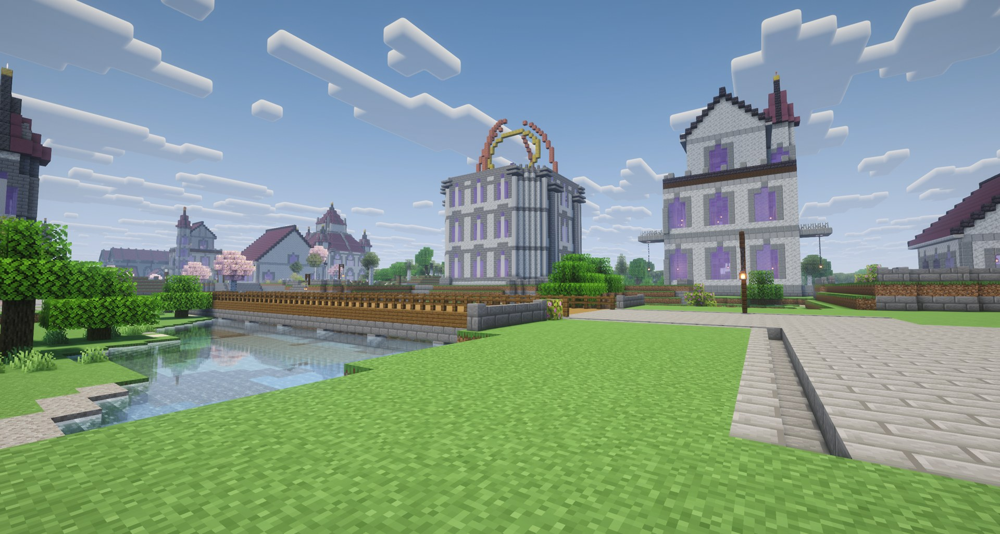
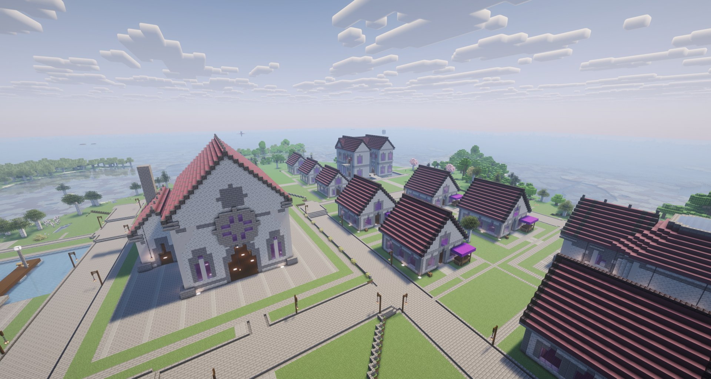
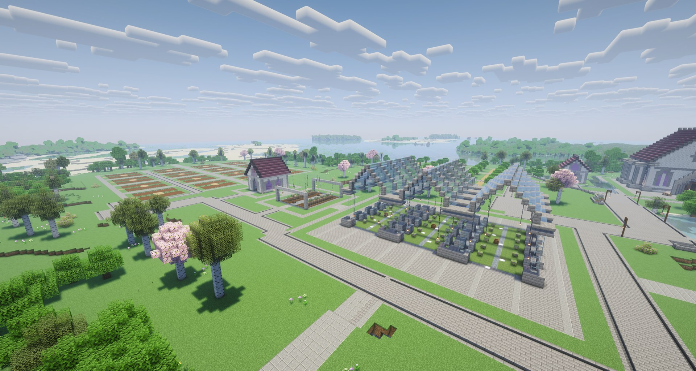

# Academy_D3_04_20261020 功能区实景报告

拍摄日期：2026-10-31。照片由用户在游戏内拍摄，来源为桌面 1031photo 文件夹。

## 拍摄位置记录

以下数值逐项转录自用户提供的六张 F3 坐标截图；功能区对应关系由用户指定。坐标顺序为 X、Y、Z。用户确认拍摄时未开启 Freecam，以下为现场玩家拍摄位置；截图未包含朝向角度。

| 图片 | 功能区 | 对应实景照片 | X | Y | Z |
| --- | --- | --- | ---: | ---: | ---: |
| 1 | 图书馆附近 | 图书馆.png | -2881.438 | 88.10192 | 5080.724 |
| 2 | 天象台 | 天象台.png | -2676.438 | 68.98737 | 5123.489 |
| 3 | 绿植教学区 | 绿植教学区.png | -2658.917 | 89.17693 | 5080.233 |
| 4 | 星厅与庭院 | 星厅+庭院.png | -2885.191 | 72.00000 | 5247.819 |
| 5 | 宿舍生活区 | 宿舍生活区.png | -2945.018 | 98.31984 | 5327.491 |
| 6 | 迎宾区 | 迎宾.png | -2824.265 | 88.53258 | 5532.301 |

上述为用户现场截图中的位置，不是先前按建筑占地计算的功能区中心。

## 六组功能区实景

本报告记录用户提供的六组游戏实景，不代表全部16个功能区均已逐一验收；建筑室内、实际通行与玩法功能未在本报告中验证。功能区名称按用户标注。

### 迎宾

临水一侧的建筑、道路和远处学院轮廓共同呈现抵达学院的环境。

### 星厅+庭院

近地视角展示星厅立面、花坛、树木与庭院之间的尺度关系。

### 图书馆

俯视画面展示塔楼式建筑、阅读庭院及周围道路；图书馆附近的建筑群具有统一的紫色装饰与红色屋顶。

### 天象台

画面中的环形观测装置形成辨识点，同时记录水边、平台与相邻塔楼的关系。

### 宿舍生活区

斜俯视展示成组住宅、较大公共建筑和网状步道，记录生活区的实际空间组织。

### 绿植教学区

较高视角展示成排种植设施、苗床与道路，记录植物教学区的整体排列。
