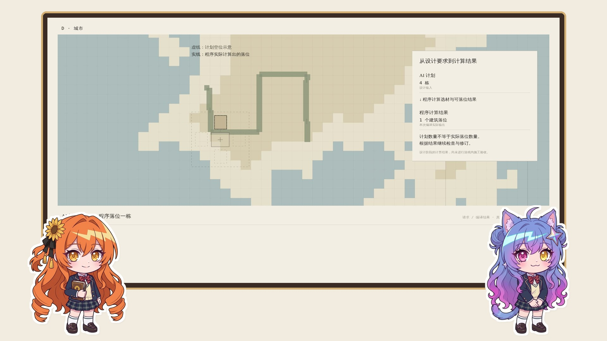
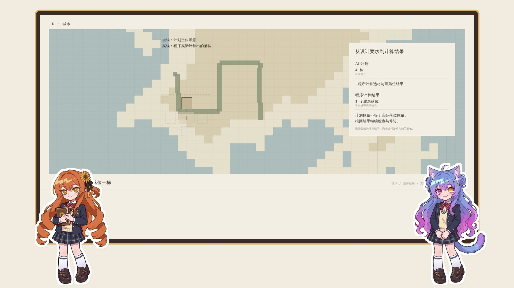
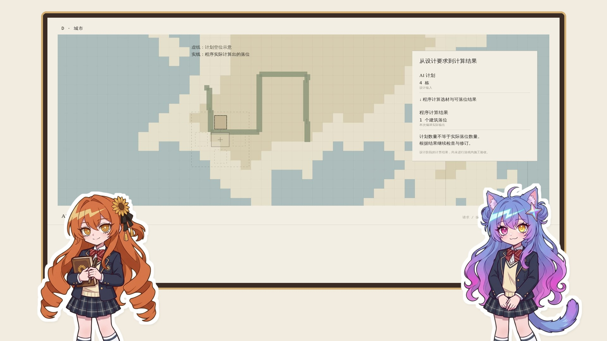

# 小克 & 猫猫：二头身 vs 原设全身比例（~3头身）同台对比

对应规范：[立绘差分交付标准（第二版）](../../../视频素材/立绘差分交付标准.md)

全部 4 张全身体态基准图（`listen_calm` 闭嘴静听姿态）已完成零残绿抠图与 14px 剪纸白边封装，并存入当前目录。

## 1. 两种头身比 · 四张全身基准立绘横向对比
- **左侧两张（2.0 头身前瞻吉祥物比例）**：
  - 小克：[`claude/claude_listen_calm.png`](claude/claude_listen_calm.png)（白边版：[`claude/trial_claude_listen_calm_sticker.png`](claude/trial_claude_listen_calm_sticker.png) / 绿幕原图：[`claude/claude_listen_calm_green.png`](claude/claude_listen_calm_green.png)）
  - 猫猫：[`gemini/gemini_2head_listen_calm.png`](gemini/gemini_2head_listen_calm.png)（白边版：[`gemini/trial_gemini_2head_listen_calm_sticker.png`](gemini/trial_gemini_2head_listen_calm_sticker.png) / 绿幕原图：[`gemini/gemini_2head_listen_calm_green.png`](gemini/gemini_2head_listen_calm_green.png)）
- **右侧两张（原设 `*_sheet.jpg` ~3 头身全身比例）**：
  - 小克：[`claude/claude_origprop_listen_calm.png`](claude/claude_origprop_listen_calm.png)（白边版：[`claude/trial_claude_origprop_listen_calm_sticker.png`](claude/trial_claude_origprop_listen_calm_sticker.png) / 绿幕原图：[`claude/claude_origprop_listen_calm_green.png`](claude/claude_origprop_listen_calm_green.png)）
  - 猫猫：[`gemini/gemini_origprop_listen_calm.png`](gemini/gemini_origprop_listen_calm.png)（白边版：[`gemini/trial_gemini_origprop_listen_calm_sticker.png`](gemini/trial_gemini_origprop_listen_calm_sticker.png) / 绿幕原图：[`gemini/gemini_origprop_listen_calm_green.png`](gemini/gemini_origprop_listen_calm_green.png)）

---

## 2. 上台实机效果三方案对比

### 方案 A：二头身比例 · 完整全身站台
- 头占比接近 50%，即使把整个人从头到脚完整放在左下/右下角，五官和小表情依然非常清晰，做整个人一蹦一跳的果冻弹跳动效最自然。

### 方案 B：原设 ~3 头身比例 · 完整全身站台
- 身形更修长（严格对齐 `*_sheet.jpg` 右侧全身比例），完整露出全身时腿部占比较高，脸部相对偏小一圈。

### 方案 C：原设 ~3 头身比例 · 放大半沉底边（二游前瞻折中摆法）
- 直接使用原设 ~3 头身全身图放大，像《星穹铁道》前瞻直播一样把小腿沉在画面底边以下（露到大腿/裙摆），既保留原设修长的上半身与手势，又把脸部放大到跟方案 A 一样清楚。

---

## 3. 早期试画方案存档

| 方案名称 | 代表文件 | 说明 |
| --- | --- | --- |
| **第一版正面半身六张全套** | [`gemini/gemini_listen_smile.png`](gemini/gemini_listen_smile.png) 等 6 张（预览：[`gemini/preview_gemini_6sprites.jpg`](gemini/preview_gemini_6sprites.jpg)） | 基于同一基准图局部改图，头肩与领结像素级对齐。 |
| **30° 四分之三微侧颜半身** | [`gemini/trial_gemini_3q_listen.png`](gemini/trial_gemini_3q_listen.png) | 头部与肩膀呈 30° 侧转，带有猫尾与托腮手势。 |
| **二头身开口主持态试画** | [`gemini/trial_gemini_chibi_2head_clean.png`](gemini/trial_gemini_chibi_2head_clean.png) / 白边：[`gemini/trial_gemini_chibi_2head_sticker.png`](gemini/trial_gemini_chibi_2head_sticker.png) | 二头身单手举起讲解姿态（双人同台预览：[`preview_claude_gemini_stage.jpg`](preview_claude_gemini_stage.jpg)）。 |
| **社长（Rin）形象选型** | 温馨少年版：[`rin/rin_listen_calm.png`](rin/rin_listen_calm.png) 剪纸白边版：[`rin/trial_rin_listen_calm_sticker.png`](rin/trial_rin_listen_calm_sticker.png) 原 P 头版：[`rin/trial_rin_phead_listen_calm.png`](rin/trial_rin_phead_listen_calm.png) 对比图：[`rin/preview_rin_vs_gemini.jpg`](rin/preview_rin_vs_gemini.jpg) | 采用同画风温和少年形象（暖棕简笔圆眼、脑后微露低扎发尾、翻领别小徽章）。 |
