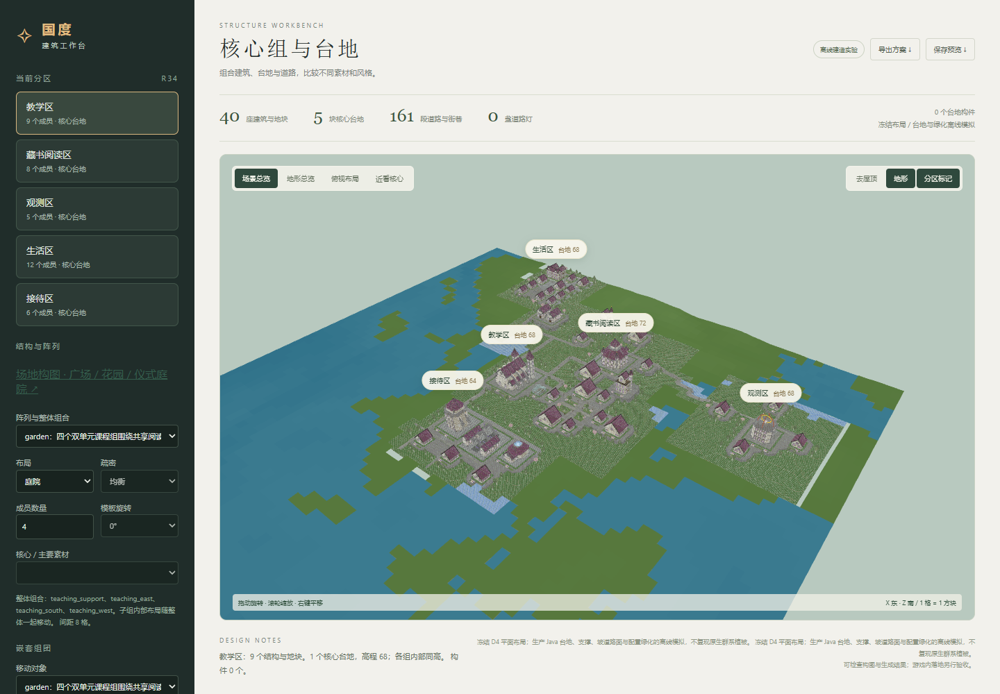
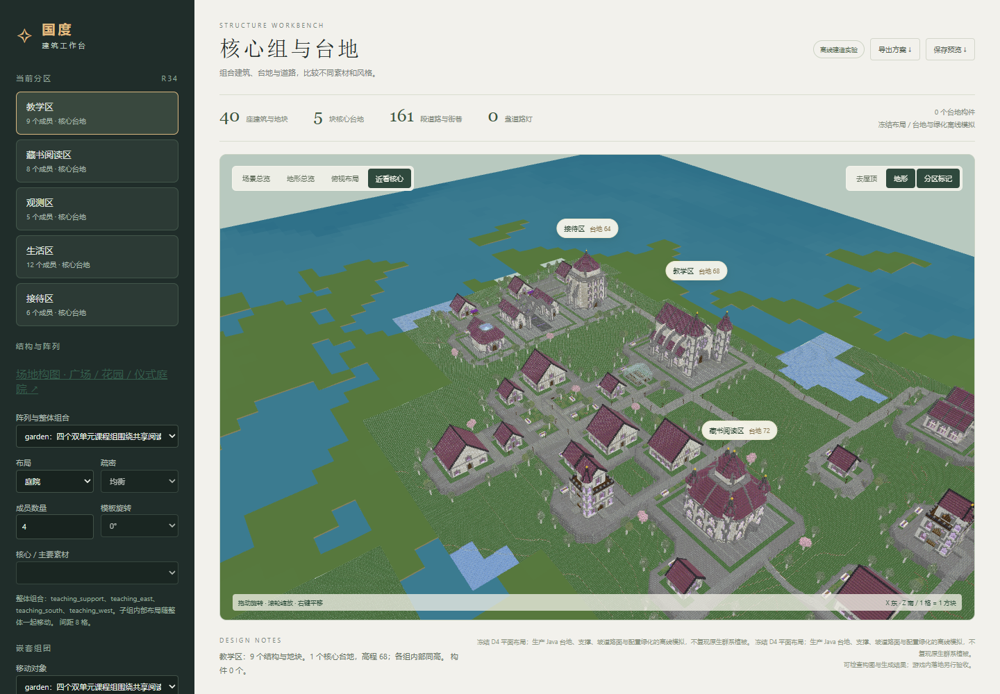

# 新 Agent D4 工程预览实验

2026-10-12：导入独立 Agent 完成的镜潮学院 D4，保持冻结建筑坐标、旋转与道路平面几何，补齐工作台台地和配置绿化，供空间质量比较。

结果：40 栋建筑、5 块台地、161 段道路、387 个绿化模板实例。Java 离线编译和前端构建通过；浏览器无运行错误及缺失纹理。几何核对见 `summary.json`。





`experiment-evidence.zip` 保存原始冻结 D4、D3 地形、预览请求、Java 结果和日志、三维世界及核对证据。解压后 `source/blueprint` 可作为导入参数；需使用匹配作者哈希的学院素材目录。

```powershell
python tools/city_experiments/import_d4_preview.py <解压路径>/source/blueprint
python tools/city_experiments/build_d4_engineered_preview.py <解压路径>/source/blueprint
```

这是离线工程与绿化模拟，未写入 MC 存档；不复现原生群系植被，植物位置不构成正式 D5 的逐项复刻。

观察：补齐台地和绿化后仍明显不及此前工作台实验，当前布局较分散。后续考虑给设计手册补充局部组合、功能区及整城空间组织的对照示范；本次尚未修改手册。
