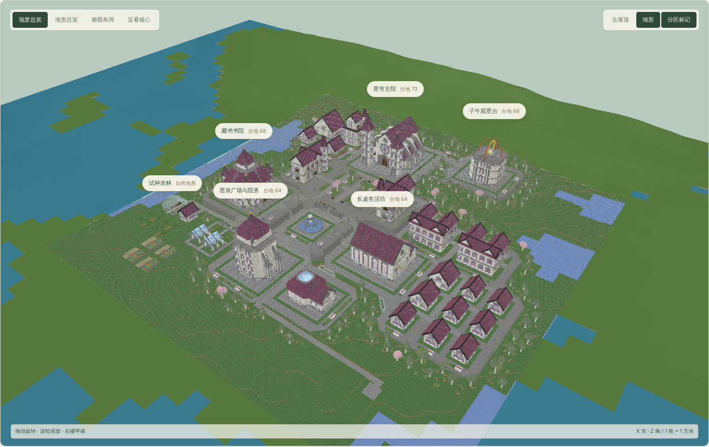
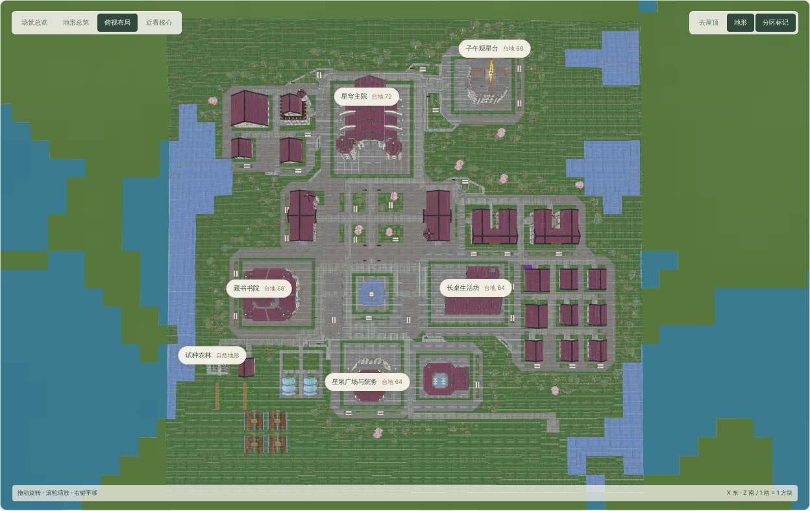
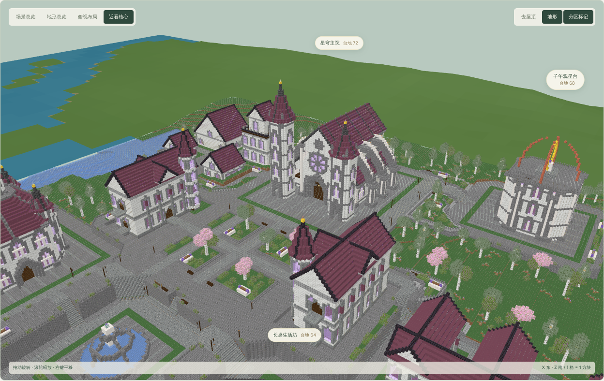
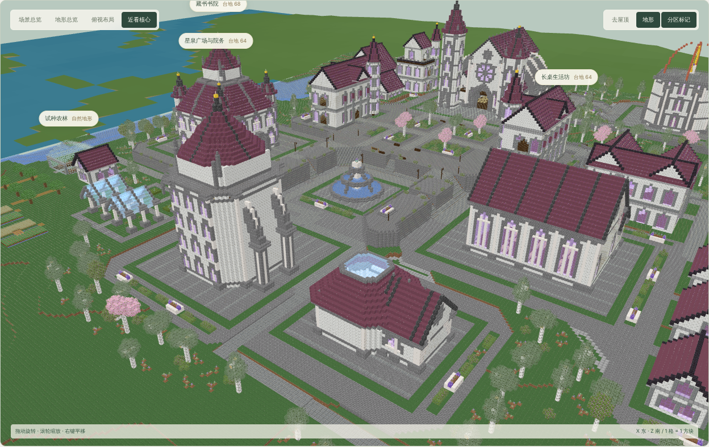

# 星穹学院：主轴构图示范

2026-10-12：针对[独立 Agent 的 D4 学院](../20261012_d4_engineered/README.md)“整体性一般、分得小而没层次”，在同一 D3 与学院素材上手工排出对照方案，用于修订 D4 提示词。方案为 `academy-starvault.json`，工作台“试验方案”中选择“学院 · 星穹主轴构图示范”可恢复。

结果：33 栋建筑与地块、5 块台地、107 段道路、23 盏路灯、654 处模板绿化，东侧海湾接岸路线通过；浏览器无运行错误和缺失纹理。

## 骨架

| 层级 | 内容 | 位置与手法 |
| --- | --- | --- |
| 主轴 | 院务塔 → 星泉广场 → 星穹主院 → 礼堂 | x≈-2920，由南向北沿坡上行 |
| 一级地标 | 星穹礼堂 MG-01 | 主峰，台地 72，朝南俯瞰主轴 |
| 主庭院 | 双教学翼楼 MG-34-v02 | COURTYARD + faceInward，礼堂居北 |
| 中心广场 | 三级星泉 MG-10 | 主轴与东西横轴交点，76×60 |
| 二级地标 | 藏书馆 MG-02、长桌食堂 MG-07、院务塔 MG-13、观星台 MG-03 | 广场西、东、南三边，观星台在主峰东肩 |
| 普通组团 | 书院课堂、宿舍街坊 | 贴主院西北与食堂东侧，DENSE，间距 5～6 |
| 外围 | 药草温室庭、农林小院、苗圃、试种田、海湾码头 | 院务塔两侧及西南、东南低地 |

台地自北向南 72 → 68 → 64；根组合只有星泉广场一个，其余锚点都紧贴它布置。对比 D4 版：6 个分散根锚点（东西相距 600 格以上）、10 个组全部用 gap 8 / BALANCED、庭院不朝内。

## 边界

藏书馆、食堂、观星台和器材店的朝向使用工作台 `rotation`；正式 D4 目前只能通过 COURTYARD `faceInward` 让叶建筑朝向庭院，没有单栋旋转字段。本结果由云端离线链路生成（生产 Java 源码离线编译，MC 资源来自 1.20.1 原版资源镜像，只用于本地渲染缓存），未写入 MC 存档，不构成游戏内验收。
